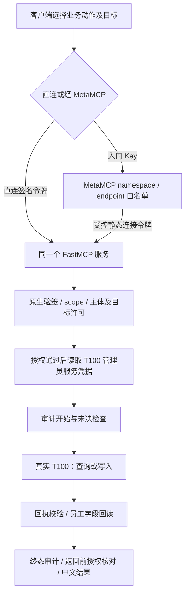

# BIZ-T100 项目梳理与文档索引

核对日期：2026-10-08；交付候选：**0.9.2**；现有部署基线：**0.9.1**。本页说明项目组织、执行链路、当前能力与文档归属；具体命令统一在 [测试说明](testing.md)，接口字段以 [工具契约](tool-contracts.md)、[上游接口契约](upstream-interfaces.md) 和对应模型为准。

## 当前功能与开放范围

三个员工档案接口加一个用户账号维护接口，组成同一个 FastMCP 服务。员工档案是账号维护的前提，员工号、登录账号和调用者身份分别处理。

| 工具 | 上游接口 | 功能及效果验证 |
|---|---|---|
| `t100_employee_create` | `employee.data.create` | 新建员工；逐条回执后精确回读可查询的提交字段 |
| `t100_employee_query` | `employee.list.data.query.get` | 按工号、姓名等检索员工；通用检索可有零条或多条候选，不能自动选人写入 |
| `t100_employee_update` | `employee.data.update` | 先查询唯一精确员工，用白名单保留其它原字段，再应用修改、写入与回读 |
| `t100_account_maintain` | `user.account.create` | 同一接口承载账号新增／修改、启用／禁用、密码重置、复制及权限明细；回执不证明实际账号效果 |

员工 `status` 属于员工档案。账号 `gzxastus=Y/N` 表示登录账号启用／禁用，`password_reset=Y` 表示请求重置密码；若同一报文设置账号状态为 Y，就同时请求启用。员工查询不能证明账号状态或密码生效，接口也不返回新密码，不推定重置后的默认密码。

四工具已实现，不代表每个调用者都能发现或执行四工具。工具发现按部署动作、可信令牌 scope 与已启用主体动作许可的交集返回，业务执行还检查企业及目标范围。

| 当前入口 | 可见工具 | 约束 |
|---|---|---|
| `client-read.json`，直连统一服务 | 员工查询一个工具 | 只查询已批准工号；当前不允许宽泛姓名检索 |
| `client-write.json`，直连同一服务 | 员工更新、账号维护两个工具 | 当前未授予员工建档许可；账号目标与员工分别核对 |
| MetaMCP 查询 endpoint | `sysmcp-t100__t100_employee_query` | namespace 工具白名单及 BIZ 目标许可共同限制 |
| MetaMCP 账号 endpoint | `sysmcp-t100__t100_account_maintain` | 仅批准账号的禁用、启用及启用状态下重置密码，不开放复制、detail 或员工写入 |

`tools` 是工具发现，不调用 T100。输出 `status=passed` 说明该次发现成功，`inputSchema` 是工具参数说明；真实业务结果需要执行具体业务子命令查看。

## 项目结构与职责

| 位置 | 职责与依赖边界 |
|---|---|
| [interfaces.py](../src/biz_t100/interfaces.py) | 四接口参数模型、动作到上游服务及请求模型的映射；不承担认证或网络调用 |
| [interface_client.py](../src/biz_t100/interface_client.py)、[client.py](../src/biz_t100/client.py) | T100 配置、统一信封、单次 HTTP 调用、响应白名单与回执判断；不负责调用者权限 |
| [functions.py](../src/biz_t100/functions.py) | 工具／scope 映射与四工具业务流程，确认、授权、原资料保留、写入及回读；通过依赖端口使用客户端和审计 |
| [server.py](../src/biz_t100/server.py) | `current_caller` 从 FastMCP 验签上下文核对主体、客户端、有效期与 scope；同时保留原本人查询工厂 |
| [access.py](../src/biz_t100/access.py) | 原本人服务的受控员工／账号映射与许可，以及私有文件读取约束；不把业务目标当调用者身份 |
| [service_runtime.py](../src/biz_t100/service_runtime.py) | 统一常驻装配、主体及目标范围许可、工具过滤、请求证据、返回前撤权核对与连接令牌签发 |
| [function_audit.py](../src/biz_t100/function_audit.py) | 业务操作库、执行事件和未决写入检查；沿用旧库占用，不替换库规避未决 |
| [cli.py](../src/biz_t100/cli.py) | 本地配置／审计检查、常驻启动和短期连接令牌签发；不是第三个业务测试脚本 |
| [runtime.py](../src/biz_t100/runtime.py) | 当前共用的并发准入、私有路径及配置检查组件；同时保留早期本人服务装配兼容 |
| `reset_*`、`account_write*`、`employee_status.py` | 保留早期写工厂及历史操作的兼容实现和回归；不作为当前四接口日常入口 |
| `scripts/offline.py`、`scripts/live.py` | 唯一两类日常测试入口；产品源码不导入 scripts 或 tests |
| `config/`、`deploy/` | 合成配置与业务报文示例、当前及旧 systemd 单元文件；示例不是生效许可，旧单元文件存在不代表运行 |
| `tests/`、`tests/legacy_support/` | 合成身份、捕获报文及契约回归；旧入口只留离线支持，不恢复日常执行 |
| `.runtime/` | 私有运行配置、签名材料、服务凭据引用、批准目标、原 DOCX、请求／回执与审计；不进入源码或制品 |
| `dist/`、`VALIDATION-*`、`docs/history/` | 按版本保存构建和验收证据、历史来源；不能追溯覆盖或用于宣称当前运行实时状态 |

本项目安装自己的 CORE 制品与锁定依赖，使用自身 `.venv`、`pyproject.toml`、`uv.lock`。CORE 提供 FastMCP 薄封装；业务语义和凭据归 BIZ，MetaMCP 服务登记、namespace、endpoint 和白名单归 GOV。不得跨项目导入内部源码或直接读写对方数据库。复用范围见根目录 [RU-005](../../../docs/reuse/RU-005-T100四接口与测试入口收敛.md)、[RU-006](../../../docs/reuse/RU-006-T100已验证脚本与测试许可修正.md)、[RU-007](../../../docs/reuse/RU-007-T100常驻服务与远程客户端.md)。

## 执行与数据流

0.9.2 本机 live 入口固定签名主体 `temporary-local-operator`；密钥和令牌仍每次临时生成，原生验签与动作／目标许可不变。该主体与员工号、登录账号和 MetaMCP Key 分离，不代表正式用户。

写操作必须显式确认。员工更新与账号维护在写前精确查询员工是否存在；前者保留未修改的白名单字段，后者单独核对批准员工／账号配对。一次工具调用可能包含前置查询、一次写入和后置回读，各请求计数分开；超时或未知写结果不自动重试。

MetaMCP 2.4.22 当前不透传外部用户 JWT，网关下游使用临时共享连接主体。入口 API Key、BIZ 调用者令牌、T100 管理员服务凭据互不替代；本版 MetaMCP Key 属于用户级，不能宣称天然绑定某个 endpoint。当前是受控内部测试，临时签名身份始终标记 `real_identity_verified=false`。

## 运行与证据状态

现有 0.9.1 部署结构及记录以 [常驻运行说明](service-runtime.md)、[0.9.1 验证](../VALIDATION-v0.9.1.md) 为准：一个 `sysmcp-biz-t100.service`，`172.17.0.1:8781/mcp`；MetaMCP 一个 `sysmcp-t100` 登记，两个 namespace／private endpoint。旧读写两个单元已在迁移时停用，文件和运行资料保留。运行状态和短期连接令牌有效期需即时检查，本页不承诺服务或令牌永久有效。

| 维度 | 已有证据 | 当前结论 |
|---|---|---|
| 0.9.2 候选 | 旧工具描述及本机测试主体修正；本轮全量离线、静态及依赖检查通过，构建另行核验，证据见 [候选验证](../VALIDATION-v0.9.2.md) | 未部署，不更新真实业务或正式发布签收 |
| 编号防重／幂等 | 编号防重、unknown 占用和不自动重试已实现；跨请求业务幂等未实现 | 正式写发布前需按公开契约闭合，不迁移本轮运行 schema |
| 逻辑／契约 | 0.9.1 的 interfaces 相关离线回归 675 项通过 | 对应范围支持 `biz-validated`；不是本轮新跑测试或全量结果 |
| 真实业务调用 | 用户反馈手测通过；本地有禁用、启用及启用状态重置的成功回执 | 保留反馈与 ACK，不能补记为自动效果验证或正式身份验收 |
| 网关组合 | 0.9.0 真实只读两跳对照；0.9.1 两端点发现、前置拒绝和三类账号确认门禁 | 内部登记／组合证据成立；0.9.1 接入没有重复真实业务写入 |
| 真实身份与权限 | 未接入正式个人身份，静态网关连接不代表外部个人 | `business-validated` 尚未通过 |
| 上游服务认证 | 旧入口曾出现错误 key 仍可调用，整改未取得本阶段验收证据 | 调用成功不等于凭据校验有效；有效／失效凭据的契约仍需分别验收 |
| 完整发布 | 当前内部 endpoint 与白名单已有组合证据，正式身份等完整条件仍缺 | `published` 尚未通过，不由内部登记自动提升 |

详细缺口见 [集成输入](integration-inputs.md)。下一阶段需要真实身份及受控员工／账号绑定、获准与拒绝用户隔离、账号效果证据和审计追踪；[DEC-001 统一维护入口](../../../docs/项目讨论与决策记录.md) 已确认需求但尚未实现，不预建完整 IAM 或新增业务测试脚本。

## 文档归属与交付

| 用途 | 权威入口 |
|---|---|
| 开发任务及优先级 | [development-checklist.md](development-checklist.md)，唯一待办矩阵 |
| 日常操作 | [testing.md](testing.md)，唯一命令指南；仍只有 offline.py 和 live.py |
| 装配与运维 | [service-runtime.md](service-runtime.md)、[operations.md](operations.md)、[startup-readiness.md](startup-readiness.md) |
| 接口与错误 | [tool-contracts.md](tool-contracts.md)、[upstream-interfaces.md](upstream-interfaces.md)、[error-codes.md](error-codes.md) |
| 验收与交付 | [offline-acceptance.md](offline-acceptance.md)、[integration-inputs.md](integration-inputs.md)、[service-release.md](service-release.md)、[0.9.2 候选验证](../VALIDATION-v0.9.2.md) |
| 决策 | [DEC-002](../../../docs/项目讨论与决策记录.md#dec-002biz-t100-交付收尾与写入幂等边界) 记录本轮边界与尚待讨论的幂等方案；DEC-001 为后续统一维护需求 |
| 历史 | [consolidation.md](consolidation.md)、[历史索引](history/20260930/README.md)、各旧版 VALIDATION；只说明对应时点 |

0.9.2 候选不覆盖已有 0.9.1 制品；新代码与最新说明按新版本构建、摘要和独立安装证据交付。本轮不改私有运行配置、不启停服务、不续签或更新网关令牌、不调用真实 T100，也不自动提交或推送。源码基线准备、本地审查、实际 Git 提交和正式审查分别记录，不用候选清单冒充提交记录。

2026-09-30 的文档整理曾验证本地链接、命令解析、合成示例、历史哈希和公开信息；这些属于当时检查，不记成本轮执行结果。各版本 VALIDATION、原 DOCX、运行资料、历史快照及制品原样保留。其它早期入口页保留导航，不增设新的日常指南或测试模式。
