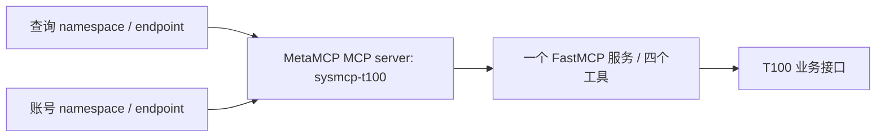

# BIZ-T100 常驻运行说明

配置适用 **0.9.2 交付候选**；现有运行基线 **0.9.1**；文档核对日期 **2026-10-08**。一个 FastMCP 服务承载四工具，MetaMCP 登记一个 `sysmcp-t100` MCP server。查询和账号操作使用两个 namespace／endpoint 的工具白名单。本文说明部署、健康检查与连接令牌维护；日常 `offline.py`／`live.py` 命令只维护在 [测试说明](testing.md)。

0.9.2 候选只做本机主体和描述修正；本轮不执行以下启动、停止、续签或登记操作，不改变现有 0.9.1 部署。候选交付与现行运行分别核验，结果见 [开发清单](development-checklist.md)。

## 当前部署基线（0.9.1）

| 项目 | 当前配置 |
|---|---|
| 运行单元 | `sysmcp-biz-t100.service` |
| 本机 MCP 地址 | `http://172.17.0.1:8781/mcp` |
| MetaMCP 下游地址 | `http://host.docker.internal:8781/mcp` |
| 服务配置 | `.runtime/service/server-maintenance.json`，`mode=maintenance` |
| 核心工具 | 员工新建、查询、更新及账号维护，装配在同一个 FastMCP 工厂 |
| 本机查询客户端 | `.runtime/service/client-read.json`，当前可见员工查询 |
| 本机维护客户端 | `.runtime/service/client-write.json`，当前可见员工更新与账号维护 |
| 网关查询客户端 | `.runtime/service/client-gateway.json`，查询 endpoint 仅暴露员工查询 |
| 网关账号客户端 | `.runtime/service/client-gateway-account.json`，账号 endpoint 仅暴露账号维护 |

`172.17.0.1` 是当前 Docker bridge 地址。服务显式允许 `host.docker.internal` Host，保留 Host／Origin 检查。两个本机客户端访问同一服务地址，以各自主体和 scope 区分权限；网关两个 namespace 引用同一个 MCP server，以工具白名单区分入口。



工具发现按部署装配动作、已启用主体动作和签名 scope 取交集。当前 read 客户端发现 1 个查询工具，write 客户端发现员工更新与账号维护 2 个工具；员工新建实现保留，但本机维护主体没有建档许可，不能由客户端 scope 或参数自行开放。网关共同连接主体仅有查询与限定账号维护权限，不获得员工更新或建档权限。当前查询主体只接受批准的工号，不开放任意姓名或部门检索。

旧 read／write systemd 单元停用，当前只使用统一单元。旧配置、运行记录和制品保留为历史资料，不作为现行启动入口，也不借此迁移或重置审计。

服务端配置、目标许可、T100 凭据和业务审计归 BIZ。客户端只持有自身签名资料、地址及必要的网关访问 Key；不能由客户端生成服务端目标许可。配置目录为 `0700`，私有文件为 `0600`，不使用符号链接。公开配置示例不包含真实员工或秘密。

## 启动与停止

在本项目目录操作：

```bash
cd /data/projects/sysmcp_dev/projects/biz-t100
uv sync --locked

# 本地配置检查，不调用 T100
.venv/bin/sysmcp-t100 check-service --config "$PWD/.runtime/service/server-maintenance.json"

# 管理统一用户服务
systemctl --user start sysmcp-biz-t100.service
systemctl --user status sysmcp-biz-t100.service --no-pager
```

需要停止时执行：

```bash
systemctl --user stop sysmcp-biz-t100.service
```

需要启用或恢复登录后自动启动设置时使用：

```bash
systemctl --user enable sysmcp-biz-t100.service
```

这是用户级服务，启动依赖该用户的 systemd 管理器；仅启用 unit 不表示已配置未登录时的机器启动。当前不修改系统级服务或用户 linger。故障日志可用 `journalctl --user -u sysmcp-biz-t100.service` 查看。

也可以在停止该 unit 后用产品 CLI 前台启动统一服务，避免端口冲突：

```bash
.venv/bin/sysmcp-t100 serve --config "$PWD/.runtime/service/server-maintenance.json"
```

`/health/live` 表示进程存活，`/health/ready` 检查当前配置、许可及审计准备状态；健康检查不调用 T100，不能替代 MCP 工具或业务验证。不要使用不存在的 `/readyz`。

## 直连测试

工具发现、真实查询以及禁用／启用／密码重置的完整直连命令见 [测试说明§选择真实调用入口](testing.md#选择真实调用入口)。`tools` 只证明 MCP 连接、验签和可见工具，不访问 T100；其 `status=passed` 与业务查询成功是不同证据。

直连默认协议 `2025-11-25`。客户端配置已经包含地址，通常不需要再传 `--endpoint`。确需覆盖时把 `--endpoint` 放在业务子命令前；端点必须符合客户端配置允许的 HTTPS 或内部 HTTP 范围。客户端不使用环境代理、不跟随重定向，不自动重试业务写入。

远程写入与原本机用例使用相同业务参数；改用 `client-write.json`，仍需 `--confirm` 和当前服务端目标许可。新工具须具备主体、scope 和目标许可，不能由客户端自动开放。当前阶段先使用已有手测写入证据，不要求为常驻验证重复写入。

查询返回 `passed` 时仍检查匹配数和目标；员工写入只有可验证字段的回执与回读一致才为 `verified`。暂未验证的日期字段应保持未验证说明。账号 `acknowledged` 仅证明成功回执，须通过账号资料或登录确认实际效果；员工档案的 `status` 不能验证账号启停或密码。

## MetaMCP 内部只读连接

MetaMCP 登记单一 MCP server `sysmcp-t100`。查询 namespace／private endpoint 为 `sysmcp-t100-internal-query`，对外工具白名单仅 `sysmcp-t100__t100_employee_query`。账号 namespace 引用同一 server。当前管理对象和组合验证由 [GOV 接入记录](../../gov/docs/t100-account-onboarding.md) 管理；[早期只读接入记录](../../gov/docs/t100-internal-onboarding.md) 保留为历史来源。

`.runtime/service/client-gateway.json` 已配置；发现与真实查询命令见 [测试说明§经 MetaMCP 查询](testing.md#经-metamcp-查询)。

所有全局选项必须放在 `tools` 或业务子命令前。工具名前缀来自统一的 MCP server 名称；namespace／endpoint 名称不改变该前缀，也不能用来切换业务动作。

MetaMCP 2.4.22 不透传外部调用者的 JWT。两个 namespace 共用受控的 `metamcp-internal-maintenance` 下游连接主体验签和授权，API Key 控制网关入口访问，BIZ 继续执行其连接主体的业务授权。现版 API Key 为用户级，即使两个客户端各自配置 Key，也不宣称 Key 天然只可访问一个端点。输出 `caller_identity_forwarded=false`，不能将其解释为真实员工身份已经经过网关传递。直连与网关 Profile 分开验收，不自动回退。

真实两跳查询与直连数据已核对一致；缺失／错误 API Key 均被拒绝，工具停用和服务停用均没有执行 BIZ 业务。这些只读证据属于 [0.9.0 历史验证](../VALIDATION-v0.9.0.md)，不替代账号入口验收。

## MetaMCP 内部账号连接

账号 namespace／private endpoint 为 `sysmcp-t100-internal-account`，与查询 namespace 引用同一 `sysmcp-t100` MCP server。其对外白名单仅 `sysmcp-t100__t100_account_maintain`；客户端配置 `.runtime/service/client-gateway-account.json` 与查询客户端及访问 Key 分开维护。下游连接 JWT 共用查询与账号维护两个 scope，不包含员工更新或建档。

完整工具名为 `sysmcp-t100__t100_account_maintain`。禁用、启用及密码重置仍由同一个工具承载，三条可执行命令统一放在 [测试说明§经 MetaMCP 执行本人账号操作](testing.md#经-metamcp-执行本人账号操作)。每项写入均显式 `--confirm`，日常不手工维护令牌、许可摘要或操作编号。

此入口的账号动作仅接受批准的一组员工／账号及五字段最小请求：`gzxa003`、`gzxa001`、`gzxastus`、`is_reproduce`、`password_reset`。固定 `is_reproduce=N`；不重置时允许 `gzxastus=Y/N`，重置时仅允许 `gzxastus=Y`。不接受复制、复制来源、权限明细、附加字段或多目标。该限制在 BIZ 的网关连接主体许可中执行，本机完整账号接口的契约保持不变。

账号网关仍为临时内部连接，不代表外部员工。接口 ACK 后通过账号资料或实际登录验证效果，不能使用员工查询的 `status`。此前 0.9.1 接入的实际验证与是否派发业务请求记入 [0.9.1 验证记录](../VALIDATION-v0.9.1.md)，不以发现工具或拒绝测试签收业务写入效果。

## 短期连接令牌维护

日常 `live.py` 调用自动产生最多五分钟的客户端令牌。MetaMCP 的单一 `sysmcp-t100` server 使用一个下游连接令牌，默认且最多有效一小时；过期后由 BIZ 运维续签，再通过 MetaMCP 受支持的管理界面／API更新该 server 的 Bearer token。两个 namespace 不需要分别续签。

```bash
.venv/bin/sysmcp-t100 issue-gateway-token \
  --config "$PWD/.runtime/service/server-maintenance.json" \
  --signing-key "$PWD/.runtime/service/maintenance-signing.pem" \
  --subject internal-gateway-maintenance \
  --client-id metamcp-internal-maintenance \
  --output "$PWD/.runtime/service/gateway-maintenance-token.jwt"
```

命令仅为已配置、启用的受控主体签发查询与账号维护 scope，不调用 T100、不读取其 key；只输出私有文件路径及到期时间，不输出令牌。网关连接不携带员工更新或建档 scope。更新文件不会自动刷新 MetaMCP 已保存的 Bearer token，必须同步更新统一 server 的连接配置。签名私钥始终留在 BIZ；网关只取得其连接所需的短期令牌。网关访问 Key、BIZ 资源令牌与 T100 服务 key 分别维护。

## 审计与验收状态

常驻调用使用原 `.runtime/functions/audit/operations.sqlite3`，同时读取旧 `.runtime/live-write/audit/account-write.sqlite3` 的未决占用；本版不以新脚本、新库或新 UUID解除旧占用。原历史记录和 `unknown` 事实保留，可读查询不受写操作占用阻塞。

服务调用证据位于 `.runtime/functions/service-cases/`，包括原始意图、实际报文、受限回执及结果；真实员工与凭据不进入公开源码或制品。调用授权在派发前、派发后及最终交付前复核，撤权后不返回员工资料。

本阶段证明常驻运行和受控内部连接；身份仍为 `real_identity_verified=false`，不签收正式 `business-validated` 或完整 `published`。部署基线的测试、构建与保存核验见 [0.9.1 验证记录](../VALIDATION-v0.9.1.md)；候选本轮结果见 [0.9.2 验证](../VALIDATION-v0.9.2.md)。统一部署以 [ADR-009](../../../docs/架构决策-009-T100账号操作网关接入.md) 为准；[ADR-008](../../../docs/架构决策-008-T100常驻运行与网关测试身份.md) 保留早期读写分离背景，[RU-007](../../../docs/reuse/RU-007-T100常驻服务与远程客户端.md) 记录复用依据。

统一维护入口已在 [DEC-001](../../../docs/项目讨论与决策记录.md) 确认为后续需求，尚未实现。目前连接令牌续签与 MetaMCP 配置更新仍是分层运维步骤，不能描述为自动跨层下发。
