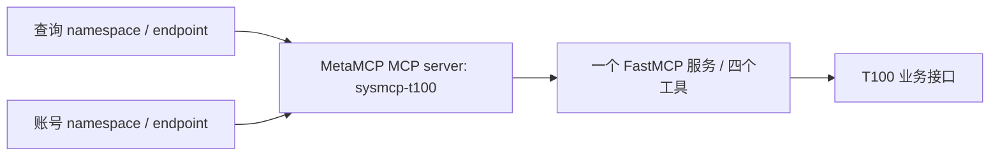

# BIZ-T100 常驻运行说明

当前部署 **0.9.2 固定 wheel**；文档核对日期 **2026-10-21**。一个 FastMCP 服务承载四工具，MetaMCP 登记一个 `sysmcp-t100` MCP server。查询和账号操作使用两个 namespace／endpoint 的工具白名单。本文说明部署、健康检查与连接令牌维护；日常 `offline.py`／`live.py` 命令只维护在 [测试说明](testing.md)。

2026-10-21 已切换固定 wheel 环境、恢复原 MetaMCP 容器并更新既有服务连接令牌；健康检查、直连及两个网关端点发现通过，本轮 T100 业务读写均为 0。现行部署证据见 [部署验证](../VALIDATION-deployment-20261021.md)，剩余事项见 [开发清单](development-checklist.md)。

## 当前部署基线（0.9.2）

| 项目 | 当前配置 |
|---|---|
| 运行单元 | `sysmcp-biz-t100.service` |
| 固定运行环境 | `.runtime/releases/0.9.2/.venv`，BIZ 0.9.2／CORE 0.1.0 非 editable wheel |
| 开发及日常脚本环境 | 项目 `.venv`；与常驻安装隔离，`uv sync` 不更新常驻服务 |
| 本机 MCP 地址 | `http://172.17.0.1:8781/mcp` |
| MetaMCP 下游地址 | `http://host.docker.internal:8781/mcp` |
| 服务配置 | `.runtime/service/server-maintenance.json`，`mode=maintenance` |
| 核心工具 | 员工新建、查询、更新及账号维护，装配在同一个 FastMCP 工厂 |
| 本机查询客户端 | `.runtime/service/client-read.json`，当前可见员工查询 |
| 本机维护客户端 | `.runtime/service/client-write.json`，当前可见员工更新与账号维护 |
| 网关查询客户端 | `.runtime/service/client-gateway.json`，查询 endpoint 仅暴露员工查询 |
| 网关账号客户端 | `.runtime/service/client-gateway-account.json`，账号 endpoint 仅暴露账号维护 |

`172.17.0.1` 是当前 Docker bridge 地址。服务显式允许 `host.docker.internal` Host，保留 Host／Origin 检查。两个本机客户端访问同一服务地址，以各自主体和 scope 区分权限；网关两个 namespace 引用同一个 MCP server，以工具白名单区分入口。



工具发现按部署装配动作、已启用主体动作和签名 scope 取交集。当前 read 客户端发现 1 个查询工具，write 客户端发现员工更新与账号维护 2 个工具；员工新建实现保留，但本机维护主体没有建档许可，不能由客户端 scope 或参数自行开放。网关共同连接主体仅有查询与限定账号维护权限，不获得员工更新或建档权限。当前查询主体只接受批准的工号，不开放任意姓名或部门检索。

旧 read／write systemd 单元停用，当前只使用统一单元。旧配置、运行记录和制品保留为历史资料，不作为现行启动入口，也不借此迁移或重置审计。

服务端配置、目标许可、T100 凭据和业务审计归 BIZ。客户端只持有自身签名资料、地址及必要的网关访问 Key；不能由客户端生成服务端目标许可。配置目录为 `0700`，私有文件为 `0600`，不使用符号链接。公开配置示例不包含真实员工或秘密。

## 固定制品安装、切换与回退

常驻环境只安装已验收 wheel，不从工作树 editable 启动。2026-10-21 已安装 73 个与锁文件一致的生产包，BIZ 21 份和 CORE 3 份产品 Python 文件与 wheel 相同。开发 `.venv` 继续用于日常脚本；修改源码或执行 `uv sync --locked` 不会自动更改常驻版本。

本机 0.9.2 部署材料在 `.runtime/deployments/20261021/`：`production-requirements.txt` 为从锁文件导出的生产依赖，排除 BIZ 本身和另供 wheel 的 CORE；`canonical-wheels.txt` 为两个 wheel 的路径与 SHA-256；`sysmcp-biz-t100.service.before` 和 `systemd.before.txt` 为切换前记录。文件留在私有目录，不纳入源码或制品。

首次安装同一制品时按以下顺序执行；当前 0.9.2 已完成，不要对现有目录重复安装：

1. 核对 BIZ `dist/SHA256SUMS-v0.9.2` 及 CORE wheel 摘要。BIZ wheel 为 `4f4f2c4eccba27cd853f2e00e5a18ec93b5b89c19e5254d145047f174b392655`，CORE wheel 为 `1eac4b1b5ed9e8bcf469ec9a92c608e455696db30240ac67af6f29981af3066f`。摘要不符即停止，不覆盖旧制品。
2. 在新版本私有目录建立 Python 3.12 环境。使用 `uv export --locked --no-dev --no-emit-project --no-emit-package sysmcp-core --format requirements-txt` 导出带哈希的完整生产依赖，保存到新的部署记录目录。新机器另需按锁文件取得相应平台 wheel；本机离线安装依赖 `.cache/uv` 已有缓存。
3. 先按哈希安装依赖，再按哈希、禁止解析新依赖安装两个正式 wheel；不使用 editable。以下是本机安装命令记录，目标环境必须尚不存在，部署材料须事先完成核对：

```bash
cd /data/projects/sysmcp_dev/projects/biz-t100
T100_RELEASE_DIR="$PWD/.runtime/releases/0.9.2"
T100_DEPLOY_RECORD="$PWD/.runtime/deployments/20261021"
test ! -e "$T100_RELEASE_DIR/.venv" || exit 1
uv venv --python 3.12 "$T100_RELEASE_DIR/.venv"
UV_CACHE_DIR=/data/projects/sysmcp_dev/.cache/uv uv pip install \
  --python "$T100_RELEASE_DIR/.venv/bin/python" --require-hashes \
  --only-binary=:all: --offline -r "$T100_DEPLOY_RECORD/production-requirements.txt"
UV_CACHE_DIR=/data/projects/sysmcp_dev/.cache/uv uv pip install \
  --python "$T100_RELEASE_DIR/.venv/bin/python" --require-hashes \
  --no-deps --offline -r "$T100_DEPLOY_RECORD/canonical-wheels.txt"
uv pip check --python "$T100_RELEASE_DIR/.venv/bin/python"
"$T100_RELEASE_DIR/.venv/bin/sysmcp-t100" check-service \
  --config "$PWD/.runtime/service/server-maintenance.json"
```

4. 核对安装版本、site-packages 导入位置、无 editable 标记及产品文件摘要，保存结果。先备份原 unit 与生效状态，再将 [统一 unit](../deploy/sysmcp-biz-t100.service) 的 `ExecStart` 指向新版本 CLI，配置仍引用原 `server-maintenance.json`；不复制或新建业务审计库。
5. 执行 `systemctl --user daemon-reload`、`systemctl --user restart sysmcp-biz-t100.service`，验证 active、live／ready 及直连工具发现，再核对网关连接令牌与两端点发现。更新 GOV 制品版本及摘要，保存部署证据；启动和发现不要求重放业务写入。
6. 若切换失败，停止新服务，恢复本次备份的 unit，reload 后启动并重新检查。当前用户 unit 是指向项目 deploy 文件的符号链接，恢复时写回该目标文件即可；原 `.venv` 保留。不要恢复旧审计快照或删除新记录，也不要改写 unknown。原环境曾为 editable 且元数据 0.9.1，不能称为可复现的旧版制品；本次未实际执行回退演练，长期回退需另备已验收固定 wheel 环境。

现有 wheel 按摘要可安装；CORE 与 BIZ 的 pyproject 构建后端仍是范围声明，但 CI 已通过独立约束固定 6 个构建包和哈希，详见 [代码交付约定](../../../docs/代码交付约定.md)。2026-10-21 CORE 重建摘要匹配；BIZ 新候选因文档元数据变化而摘要不同，未替换现行 wheel。跨机器安装和回退演练继续列在开发清单，不覆盖原 0.9.2 制品。

## 启动与停止

在本项目目录操作：

```bash
cd /data/projects/sysmcp_dev/projects/biz-t100

# 使用固定服务环境检查本地配置，不调用 T100
.runtime/releases/0.9.2/.venv/bin/sysmcp-t100 check-service --config "$PWD/.runtime/service/server-maintenance.json"

# 管理统一用户服务
systemctl --user start sysmcp-biz-t100.service
systemctl --user status sysmcp-biz-t100.service --no-pager
```

计划停机时先停止连接续签 timer，并等待两个签发／同步单元结束，再停止 BIZ；否则下一轮定时任务会通过依赖重新启动 BIZ。具体维护检查见 [GOV 续签说明](../../gov/docs/connector-renewal.md#维护检查)。

```bash
systemctl --user stop sysmcp-t100-gateway-sync.timer
# 确认签发和同步单元均已结束后：
systemctl --user stop sysmcp-biz-t100.service
```

需要启用或恢复登录后自动启动设置时使用：

```bash
systemctl --user enable sysmcp-biz-t100.service
```

这是用户级服务，启动依赖该用户的 systemd 管理器。2026-10-21 已启用并核对 `Linger=yes`，统一 unit 保持 enabled；Docker 宿主 active／enabled，原 MetaMCP 应用容器改为 `unless-stopped`，Compose 固定应用与数据库原镜像摘要。启动配置已就绪，尚未重启机器演练，不宣称开机恢复已经实测。故障日志可用 `journalctl --user -u sysmcp-biz-t100.service` 查看。

也可以在停止该 unit 后用产品 CLI 前台启动统一服务，避免端口冲突：

```bash
.runtime/releases/0.9.2/.venv/bin/sysmcp-t100 serve --config "$PWD/.runtime/service/server-maintenance.json"
```

`/health/live` 表示进程存活，`/health/ready` 检查当前配置、许可及审计准备状态；健康检查不调用 T100，不能替代 MCP 工具或业务验证。不要使用不存在的 `/readyz`。

## 直连测试

工具发现、真实查询以及禁用／启用／密码重置的完整直连命令见 [测试说明§选择真实调用入口](testing.md#选择真实调用入口)。`tools` 只证明 MCP 连接、验签和可见工具，不访问 T100；其 `status=passed` 与业务查询成功是不同证据。

直连默认协议 `2025-11-25`。客户端配置已经包含地址，通常不需要再传 `--endpoint`。确需覆盖时把 `--endpoint` 放在业务子命令前；端点必须符合客户端配置允许的 HTTPS 或内部 HTTP 范围。客户端不使用环境代理、不跟随重定向，不自动重试业务写入。

远程写入与原本机用例使用相同业务参数；改用 `client-write.json`，仍需 `--confirm` 和当前服务端目标许可。新工具须具备主体、scope 和目标许可，不能由客户端自动开放。当前阶段先使用已有手测写入证据，不要求为常驻验证重复写入。

查询返回 `passed` 时仍检查匹配数和目标；员工写入只有可验证字段的回执与回读一致才为 `verified`。暂未验证的日期字段应保持未验证说明。账号 `acknowledged` 仅证明成功回执，须通过账号资料或登录确认实际效果；员工档案的 `status` 不能验证账号启停或密码。

## MetaMCP 内部只读连接

MetaMCP 登记单一 MCP server `sysmcp-t100`。查询 namespace／private endpoint 为 `sysmcp-t100-internal-query`，对外工具白名单仅 `sysmcp-t100__t100_employee_query`。账号 namespace 引用同一 server。当前管理对象和组合验证由 [GOV 接入记录](../../gov/docs/t100-account-onboarding.md) 管理；[早期只读接入记录](../../gov/docs/t100-internal-onboarding.md) 保留为历史来源。

`.runtime/service/client-gateway.json` 已配置；发现与真实查询命令见 [测试说明§经 MetaMCP 查询](testing.md#经-metamcp-查询)。

所有全局选项必须放在 `tools` 或业务子命令前。工具名前缀来自统一的 MCP server 名称；namespace／endpoint 名称不改变该前缀，也不能用来切换业务动作。

MetaMCP 2.4.22 不透传外部调用者的 JWT。两个 namespace 共用受控的 `metamcp-internal-maintenance` 下游连接主体验签和授权，API Key 控制网关入口访问，BIZ 继续执行其连接主体的业务授权。现版 API Key 为用户级，即使两个客户端各自配置 Key，也不宣称 Key 天然只可访问一个端点。输出 `caller_identity_forwarded=false`，不能将其解释为真实员工身份已经经过网关传递。直连与网关 Profile 分开验收，不自动回退。

真实两跳查询与直连数据已核对一致；缺失／错误 API Key 均被拒绝，工具停用和服务停用均没有执行 BIZ 业务。这些只读证据属于 [0.9.0 历史验证](../VALIDATION-v0.9.0.md)，不替代账号入口验收。

## MetaMCP 内部账号连接

账号 namespace／private endpoint 为 `sysmcp-t100-internal-account`，与查询 namespace 引用同一 `sysmcp-t100` MCP server。其对外白名单仅 `sysmcp-t100__t100_account_maintain`；客户端配置 `.runtime/service/client-gateway-account.json` 与查询客户端及访问 Key 分开维护。下游连接 JWT 共用查询与账号维护两个 scope，不包含员工更新或建档。

完整工具名为 `sysmcp-t100__t100_account_maintain`。禁用、启用及密码重置仍由同一个工具承载，三条可执行命令统一放在 [测试说明§经 MetaMCP 执行本人账号操作](testing.md#经-metamcp-执行本人账号操作)。每项写入均显式 `--confirm`，日常不手工维护令牌、许可摘要或操作编号。

此入口的账号动作仅接受批准的一组员工／账号及五字段最小请求：`gzxa003`、`gzxa001`、`gzxastus`、`is_reproduce`、`password_reset`。固定 `is_reproduce=N`；不重置时允许 `gzxastus=Y/N`，重置时仅允许 `gzxastus=Y`。不接受复制、复制来源、权限明细、附加字段或多目标。该限制在 BIZ 的网关连接主体许可中执行，本机完整账号接口的契约保持不变。

账号网关仍为临时内部连接，不代表外部员工。接口 ACK 后通过账号资料或实际登录验证效果，不能使用员工查询的 `status`。此前 0.9.1 接入的实际验证与是否派发业务请求记入 [0.9.1 验证记录](../VALIDATION-v0.9.1.md)，不以发现工具或拒绝测试签收业务写入效果。

## 短期连接令牌维护

自动续签覆盖网关登记及后续新建会话。MetaMCP 2.4.22 的已建立长会话不能热切换 JWT；当前 live.py 每次新建会话，持久客户端需在请求结束后关闭旧会话再连接，不能自动重发业务写入。详见 [GOV 兼容边界](../../gov/docs/connector-renewal.md#验证与兼容)。

日常 `live.py` 调用自动产生最多五分钟的客户端令牌。MetaMCP 的单一 `sysmcp-t100` server 使用一个下游连接令牌，默认且最多有效一小时；两个 namespace 共用一次续签。2026-10-21 已新增两段独立运维单元：BIZ `sysmcp-t100-gateway-token.service` 调用既有 CLI，把受控主体令牌发布至 `.runtime/exports/metamcp-connector.jwt`；GOV `sysmcp-t100-gateway-sync.service` 只读取这一交接 JWT，通过受支持管理 API 更新原 server 的 Bearer token，并回读核验其它字段不变。`sysmcp-t100-gateway-sync.timer` 已 enabled／active，启用约一分钟后首次触发，随后每 20 分钟调度并保留 Persistent。手动首轮和定时自动轮均同步成功且令牌摘要不同；最近结果以 [GOV 续签说明](../../gov/docs/connector-renewal.md) 和 [运维验证](../../gov/VALIDATION-operations-20261021.md) 为准。早期手动令牌到期时间只属于原部署记录，不能作为当前有效期。

```bash
.runtime/releases/0.9.2/.venv/bin/sysmcp-t100 issue-gateway-token \
  --config "$PWD/.runtime/service/server-maintenance.json" \
  --signing-key "$PWD/.runtime/service/maintenance-signing.pem" \
  --subject internal-gateway-maintenance \
  --client-id metamcp-internal-maintenance \
  --output "$PWD/.runtime/exports/metamcp-connector.jwt"
```

命令仅为已配置、启用的受控主体签发查询与账号维护 scope，不调用 T100、不读取其 key；只输出私有文件路径及到期时间，不输出令牌。网关连接不携带员工更新或建档 scope。单独执行该命令只签发文件，不完成 MetaMCP 发布；两段运维链执行成功才表示网关令牌同步，具体状态检查与恢复统一见 GOV 续签说明。签发失败、管理认证失败或核验失败不得显示整体成功。签名私钥始终留在 BIZ；GOV 只读取专门交接目录中的短期令牌，不读取 BIZ 运行配置、员工映射、许可或服务 key。网关访问 Key、BIZ 资源令牌与 T100 服务 key 分别维护。

## 审计与验收状态

常驻调用使用原 `.runtime/functions/audit/operations.sqlite3`，同时读取旧 `.runtime/live-write/audit/account-write.sqlite3` 的未决占用；本版不以新脚本、新库或新 UUID解除旧占用。原历史记录和 `unknown` 事实保留，可读查询不受写操作占用阻塞。

服务调用证据位于 `.runtime/functions/service-cases/`，包括原始意图、实际报文、受限回执及结果；真实员工与凭据不进入公开源码或制品。调用授权在派发前、派发后及最终交付前复核，撤权后不返回员工资料。

本阶段证明常驻运行和受控内部连接；身份仍为 `real_identity_verified=false`，不签收正式 `business-validated` 或完整 `published`。现行部署、实际下游确认门禁及缺失／错误 Key 拒绝见 [2026-10-21 部署验证](../VALIDATION-deployment-20261021.md)；1940 项离线与构建记录见 [2026-10-08 的 0.9.2 验证](../VALIDATION-v0.9.2.md)，早期拓扑迁移见 [0.9.1 历史验证](../VALIDATION-v0.9.1.md)。MetaMCP 原容器已设置 `unless-stopped`，Compose 两个镜像固定原 digest，未拉取、重建或升级；BIZ 用户 Linger 已启用。持续运行配置和续签现场证据见 [运维验证](../../gov/VALIDATION-operations-20261021.md)，实际重启恢复及回退仍另行验收。统一部署以 [ADR-009](../../../docs/架构决策-009-T100账号操作网关接入.md) 为准；[ADR-008](../../../docs/架构决策-008-T100常驻运行与网关测试身份.md) 保留早期读写分离背景，[RU-007](../../../docs/reuse/RU-007-T100常驻服务与远程客户端.md) 记录复用依据。

统一维护入口已在 [DEC-001](../../../docs/项目讨论与决策记录.md) 确认为后续需求，尚未实现。当前新增的两段续签只自动化既有连接凭据的受控发布；员工／账号绑定、业务授权与服务登记的统一维护入口仍未实现，不能将续签工具描述为通用跨层管理平台。
