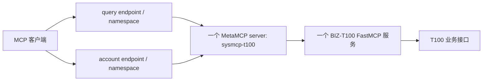

# GOV 项目梳理与文档索引

核对日期：2026-09-30；产品基线：**MetaMCP 2.4.22**；当前T100制品：**BIZ-T100 0.9.1**。本页说明治理目录、当前登记关系、证据和文档归属，不执行配置发布。业务调用命令统一见 [BIZ测试说明](../../biz-t100/docs/testing.md)。

## 责任与管理范围

GOV保存服务登记、环境地址引用、协议Profile、工具白名单、namespace／endpoint关系及去敏组合证据。它不实现T100业务逻辑，不持有员工映射、业务许可、上游服务凭据、完整业务响应或BIZ审计数据库；业务规则与状态继续归各BIZ项目。控制面责任见 [ADR-004](../../../docs/架构决策-004-GOV统一服务注册与发布.md)，当前T100部署决定见 [ADR-009](../../../docs/架构决策-009-T100账号操作网关接入.md)。

本目录管理的当前T100对象是一个MCP server、两个namespace和两个private endpoint。这个数量不能用来判断整个既有MetaMCP实例是否有其它服务。GOV目录是可审查的登记描述，不是MetaMCP声明式导入文件、自动下发器或实时健康状态源。

## 对象层次与当前关系

| 层次 | 当前T100对象 | 职责 |
|---|---|---|
| BIZ开发项目 | `projects/biz-t100` | 独立源码、依赖、契约、测试与制品；不按每项操作建立新项目 |
| FastMCP运行单元 | 一个 `sysmcp-biz-t100.service` | 同一维护工厂承载四工具；实际发现与执行仍受主体许可限制 |
| MetaMCP MCP server | `sysmcp-t100` | 连接同一个BIZ地址，使用受控内部连接令牌 |
| namespace | `sysmcp-t100-internal-query`、`sysmcp-t100-internal-account` | 都引用该server；各自工具白名单只开放一项 |
| private endpoint | 同名query／account入口 | 入口API Key访问控制与MCP聚合地址，不作为个人员工身份 |
| 工具与业务操作 | 员工查询、账号维护 | 账号禁用、启用和密码重置复用同一个维护工具 |

| 入口 | 对外工具 | 目录来源 |
|---|---|---|
| query | `sysmcp-t100__t100_employee_query` | [查询namespace](../catalog/namespaces/sysmcp-t100-internal-query.toml)、[查询endpoint](../catalog/endpoints/sysmcp-t100-internal-query.toml) |
| account | `sysmcp-t100__t100_account_maintain` | [账号namespace](../catalog/namespaces/sysmcp-t100-internal-account.toml)、[账号endpoint](../catalog/endpoints/sysmcp-t100-internal-account.toml) |

下游地址引用是 `http://host.docker.internal:8781/mcp`，BIZ当前绑定 `172.17.0.1:8781/mcp`；两个入口的本机地址引用见 [当前环境](../environments/internal/t100.toml)。这些是内部环境记录，不能据此宣称公网开放。

查询入口只接受BIZ批准工号，当前不开放任意姓名／部门检索。账号入口受BIZ `status-password` profile限制，仅批准账号的禁用、启用、启用状态下密码重置；不开放员工新建／更新、账号复制或权限明细。员工 `status` 属于档案，账号 `gzxastus` 属于登录账号；账号ACK须实际账号资料或登录证据确认效果。字段、目标和授权规则的权威定义留在BIZ，GOV仅引用 [工具契约](../../biz-t100/docs/tool-contracts.md)。

## 目录组织与权威来源

| 位置 | 用途与当前归属 |
|---|---|
| [selection.toml](../selection.toml) | 2026-09-29产品选型基线；其中not-run或待核实注释是当时状态，不覆盖后来T100组合证据 |
| [catalog/services/sysmcp-t100.toml](../catalog/services/sysmcp-t100.toml) | 当前T100服务版本、制品摘要、MetaMCP对象ID、允许工具及证据引用 |
| `catalog/namespaces/` | 两namespace的服务关联、工具暴露与排除清单 |
| `catalog/endpoints/` | 两private endpoint的namespace、入口认证开关及私有Key引用 |
| [environments/internal/t100.toml](../environments/internal/t100.toml) | 当前T100统一运行单元与两个入口的非秘密地址引用 |
| [旧query服务目录](../catalog/services/sysmcp-t100-internal-query.toml)、[旧query环境](../environments/internal/t100-query.toml) | 0.9.0阶段来源；服务已retired并replaced_by当前登记，环境已标为历史 |
| `.runtime/` | GOV管理账号、会话、入口Key、实际对象记录；真值不进入公开文档或制品 |
| [部署记录](../部署记录.md) | 分阶段说明运行产品、镜像、网络条件、迁移和证据边界 |
| [历史只读验证](../VALIDATION-internal-t100-20260930.md) | 0.9.0真实只读对照与拒绝证据；原文不追溯改写 |

目录中的9份TOML是产品选型、当前及历史登记描述；现阶段没有自动同步它们到MetaMCP的工具。运行变更使用固定版本已验证的受支持管理界面／API并保存对象ID及结果，不直接修改产品数据库。不同角色的来源不得混用：制品字段引用BIZ发布描述，真实网关对象使用管理记录，验证结论引用对应时点证据。

## 身份、凭据与协议边界

MetaMCP2.4.22当前不透传外部用户JWT。两个namespace共用查询＋账号维护scope的临时下游连接主体，BIZ验证该主体并继续检查目标许可；它不代表调用网关的真实员工。现版API Key是用户级访问凭据，不天然绑定一个endpoint；分别配置Key不证明员工权限或跨端点身份隔离。

GOV入口／管理凭据、BIZ资源身份令牌、T100管理员服务凭据是三类不同材料。BIZ私钥、员工／账号映射和上游key留BIZ；MetaMCP只保存连接所需短期Bearer Token。下游连接令牌默认且最长一小时，需要BIZ续签后更新统一server已保存的Bearer Token；仅替换本地文件不会使网关自动更新。实际步骤唯一引用 [BIZ运行说明](../../biz-t100/docs/service-runtime.md)，没有自动刷新能力。

网关兼容链路显式验收 `2025-06-18` initialize，直连BIZ显式验收 `2025-11-25`；不自动回退。原 `2026-07-28` 现代协议目标不能用CORE单组件探针或旧Profile抵扣，保持未验收。

## 已有证据与未闭环项

| 维度 | 证据来源 | 当前结论 |
|---|---|---|
| 产品身份 | 2026-09-30部署记录核对2.4.22、revision与应用／数据库digest | 运行身份已记录；Compose浮动引用未完成重部署制品固定 |
| T100内部登记 | 当前catalog及BIZ0.9.1迁移记录 | `gov-registered`／`composed`，单server、双namespace／endpoint |
| 真实只读对照 | GOV0.9.0验证、BIZ0.9.0验证 | 当时直连与两跳返回一致；历史旧server及prefix后来被替代 |
| 当前工具与门禁 | [BIZ0.9.1验证](../../biz-t100/VALIDATION-v0.9.1.md) | 两端点发现、跨端点直接调用拒绝、错误Key、工具／服务停用及三类账号确认门禁有证据；该次T100读写为0 |
| BIZ逻辑 | 0.9.1的675项相关离线回归 | 属于BIZ声明范围，不记成GOV产品测试或本轮新跑结果 |
| 真实身份与账号效果 | [BIZ集成输入](../../biz-t100/docs/integration-inputs.md) | 真实个人身份／员工隔离、上游服务认证整改与账号效果仍需独立验收，`business-validated`未签收 |
| 完整发布 | 上述内部证据与正式准入条件分别核对 | `published`未签收，端点存在与工具发现不自动提升状态 |

产品及网络隔离的目标基线与实际部署仍需分别核对，不能把README目标要求当作已经生效。部署记录中的短暂启停观察时间是当时测量值，不承诺永久最大生效时限。

后续 [DEC-001统一维护入口](../../../docs/项目讨论与决策记录.md) 已确认需求但尚未实现：可以集中提交链路维护变更，各层权威数据仍分别归身份源、BIZ和GOV。当前目录不自动完成身份绑定、授权变更或跨层下发，不预建新IAM或业务测试脚本。

## 文档导航与本轮订正

| 需要了解的内容 | 文档及本轮订正 |
|---|---|
| GOV总览与当前状态 | [README](../README.md)：补单服务双入口、管理范围限定、目录与状态来源 |
| 通用交付与接入规则 | [service-onboarding](service-onboarding.md)：区分对象层次，运行单元按经验证的风险与信任边界决定 |
| 当前查询／账号接入 | [t100-account-onboarding](t100-account-onboarding.md)：明确各endpoint各一工具、三账号动作及身份／Key限制 |
| 早期只读过程 | [t100-internal-onboarding](t100-internal-onboarding.md)：前置0.9.1导航，原0.9.0过程明确归为历史 |
| 运行与迁移记录 | [部署记录](../部署记录.md)：按0.9.1、0.9.0、初次核实分阶段，不把旧prefix或只读范围当现状 |
| 业务调用与常驻运维 | [BIZ测试说明](../../biz-t100/docs/testing.md)、[BIZ运行说明](../../biz-t100/docs/service-runtime.md)：只引用唯一指南，不复制出另一套命令 |

本轮更新GOV的README、部署记录及三份接入说明，新增本页；同步根README、STATUS与ADR-004的当前导航和历史范围。9份登记／环境／选型TOML、GOV私有认证资料及历史VALIDATION保持原样；BIZ源码、脚本、文档、制品、许可及审计保持原样。没有管理API变更、实际发布、凭据续签或真实T100调用，原组合与业务证据不因此增加。

## 本轮文档核验结果

| 检查 | 实际结果 |
|---|---|
| 文档引用 | 10份GOV及关联Markdown，148个本地链接、其中4个标题锚点有效，代码围栏完整 |
| 登记关系 | 9份TOML只读解析通过，19项版本／制品摘要／服务／namespace／endpoint／环境及引用检查通过 |
| 有效与历史区分 | 当前服务composed、旧query服务retired并指向替代服务；两namespace仍关联当前服务、各暴露一工具 |
| 状态与身份 | published／business_validated仍为false，外部用户未透传，临时连接最长3600秒且无自动刷新 |
| GOV保存 | 9份元数据、11份私有资料、1份历史验证，整理前后文件集合与内容摘要一致 |
| BIZ保存 | 实现／测试／配置／部署／依赖及制品148份、私有运行资料332份、文档及历史证据54份，整理前后文件集合与内容摘要一致 |
| 公开资料 | 核对页面不含本轮已知真实员工工号、姓名、邮箱或电话 |
| 操作边界 | 管理API调用0，T100读取0、写入0；未重跑工程测试、未构建制品或增加日常脚本 |

本轮检查验证文档、已存登记及证据引用的一致性，没有重新签收运行健康、令牌有效期、业务效果或正式发布。
