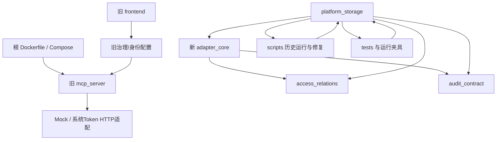
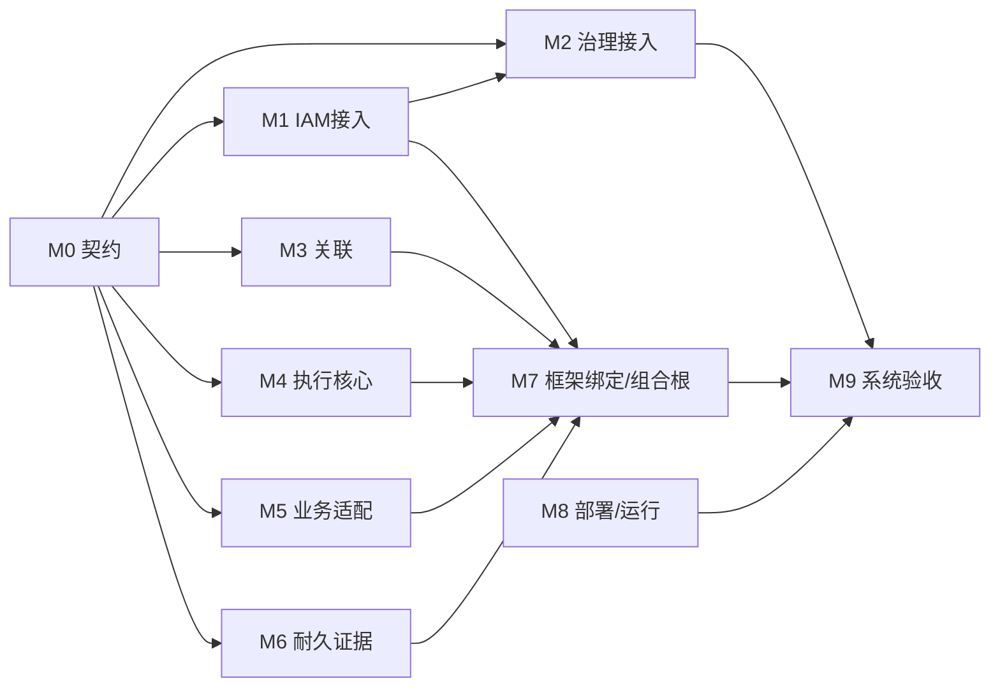
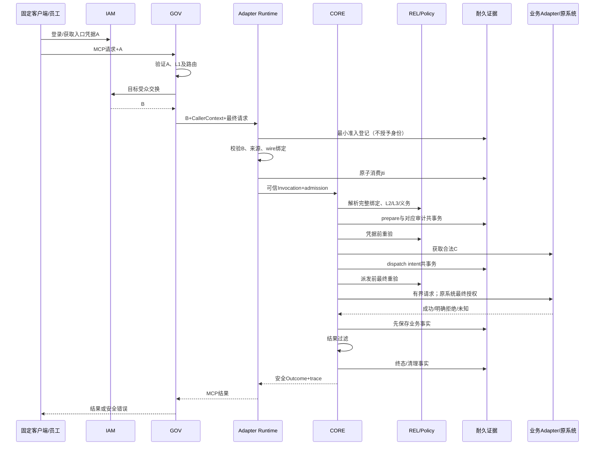

# mcp_auth_demo 项目架构分析与模块化闭环规划

报告日期：2026-09-29  
分析对象：`/data/projects/mcp_auth_demo`  
代码基线：`d421e11e0c9a120b5c593997333e70babc308c6d`；扫描时工作区无未提交变更。  
后续工作空间：`/data/projects/sysmcp_dev`。本文将用户所说的“当前文件夹”解释为该工作空间；原项目保留为封存资产。  
性质：基于全量清点、文本及 AST 静态扫描、重点语义核对和既有验收记录的架构分析；不是新的运行验收，也没有启动开发、修改原项目或恢复旧环境。

## 0. 结论与优先级

**项目已经形成较完整的架构设计、旧演示系统和较强的隔离数据库事务能力，但尚未形成一条经过真实业务权限验证的统一运行链。问题主要是交付顺序、接口演进和工程装配没有围绕同一次业务调用闭合，而不是缺少更多模块名称。**

原目标保持不变：企业 AI 经统一身份和 MCP 治理入口，使用合法业务身份访问既有 ERP/OA/CRM；原系统仍决定最终数据和操作权限；全程可追踪；不建设新的 AI 平台。

必须区分三个完成层次：

| 层次 | 交付定义 | 当前判断 |
|---|---|---|
| 局部模块完成 | 某个模块在明确环境、输入和验收范围内通过 | FND-01 已交付；FND-02 在限定隔离环境内有运行签收；其他部分存在离线实现或候选 |
| 最小只读闭环 | 一个真实系统、一个只读工具、具名用户和固定客户端经过完整身份、治理、执行和审计链 | 未完成；作为重新组织后的首个业务里程碑 |
| 原一期完成 | 真实一读一低风险写入，四级权限、受众隔离、幂等、未知结果处理、撤权、审计与回退交接全部成立 | 未完成；不能由只读闭环替代 |

优先处理顺序：

1. 锁定真实业务候选及合法用户调用方式，同时验证正式组件组合和身份委托是否可行。
2. 冻结一个受限只读运行 Profile，统一关联 V2、可信请求、异步执行和耐久记录契约。
3. 将必要能力做成独立可构建项目，尽早接通一条真实只读路径。
4. 通过只读里程碑后扩展低风险写入，完成原一期目标。
5. 根据真实业务规模和风险扩展审计外送、高可用及完整恢复；不默认从旧 FND-03 重试继续。

这一方向与最新 ADR-021 一致。本文提供可执行规划，不把尚未确认的业务资料、受限 Profile 或运行验收写成已完成。[E01][E02][E03]

## 1. 扫描范围、方法与证据口径

### 1.1 全量清点结果

扫描覆盖整个目标目录，包括隐藏目录、Git 元数据、虚拟环境、前端依赖、缓存及运行文件；不跟随目录符号链接，避免重复统计。共记录 **12,271 个文件或符号链接条目**：12,270 个文件条目及一个目录符号链接。完整路径见同目录 `file-inventory.csv`，目录清单见 `directory-tree.txt`。

| 文件类别 | 条目数 | 本次处理 |
|---|---:|---|
| Git 管理的项目资产 | 1,405 | 全部读取、计算 SHA-256、扫描 UTF-8 文本；Python 建立语法树和符号索引 |
| 第三方依赖环境 | 8,499 | 全量枚举路径、类型和大小；不把依赖包源码当成本项目实现逐行审查 |
| Git 元数据 | 1,945 | 清点路径和大小，核对 HEAD 与工作区状态 |
| 生成缓存 | 323 | 元数据清点，不以字节码判断功能状态 |
| 构建产物 | 86 | 元数据清点；不执行历史产物 |
| 私密或运行配置 | 12 | 仅清点，不读取 `.env` 等私密内容，不在报告复制凭据 |
| 本地辅助文件 | 1 | 清点用途和位置，不视为目标架构权威来源 |

“全量扫描”在这里指全目录清点和全部版本管理资产的文本/结构扫描；**不意味着逐行人工审查全部第三方依赖或运行配置**。核心源码由运行链、存储契约、计划与证据三个方向交叉核对。606 个版本管理的 Python 文件均可被 AST 解析，其中包含文档中的历史源码快照；本次未发现 Python 语法解析错误。这不证明依赖可安装、接口兼容或运行正确。

### 1.2 交付附件

| 文件 | 用途 |
|---|---|
| `file-inventory.csv` | 每个文件的路径、类别、大小、扫描层次，以及项目资产摘要 |
| `directory-tree.txt` | 完整目录结构索引，包括隐藏目录；目录符号链接不递归 |
| `scan-summary.json` | 基线、分类统计、源码规模、解析结果与扫描限制 |
| `python-imports.csv` | 6,898 条静态导入记录，附源文件和行号；包含测试、脚本和历史快照 |
| `project-symbol-index.json` | 每个项目文件的行数、Python 类/函数/导入及 Markdown 标题索引 |

### 1.3 事实优先级

当前状态以 2026-09-28 封存说明、进度报告和 ADR-021 为最高入口；FND-02 的限定接受以 R111 及运行总结为依据。旧计划、README 和候选源码注释中的“下一步”“尚未执行”可能早于后续记录，只用于理解历史，不覆盖最新状态。

本次没有重跑单元测试、历史回归、数据库脚本、协议探针或业务请求，没有连接 Keycloak、ContextForge、数据库和兄弟仓库运行环境；没有查询上游最新版本。下文产品版本兼容性仅引用仓库中固定版本、固定日期的证据，不推断今天所有版本的状态。

## 2. 当前目录与模块划分

### 2.1 项目资产结构

以下计数是 Git 管理的文件数，不含依赖缓存。

```text
mcp_auth_demo/                         1,405 files
├── src/                                124
│   ├── mcp_server/                       23  旧演示服务、认证、策略、Tool、模拟/HTTP适配
│   ├── access_relations/                  6  关联模型与同步领域读取
│   ├── adapter_core/                     11  新执行模型、端口、离线管线
│   ├── audit_contract/                    2  审计事件与持久化端口
│   └── platform_storage/                 82  PostgreSQL原语及大量运行/恢复/验收设施
├── scripts/                            207  旧回归、设施运行、补测、诊断、恢复、预检
├── tests/                              229  197个测试文件＋32个测试支撑文件
├── docs/                               769
│   ├── 顶层规划与状态文档                 11
│   ├── design/                            8  TS-00～06及索引
│   ├── i0/                                6
│   ├── i1/                                3
│   ├── i2/                              366  设施工作包、证据和候选补丁
│   └── reviews/                         375  历史审核与冻结证据
├── deploy/                              53  I0/FND部署、锁文件、迁移及多代候选
├── frontend/                            10  旧浏览器调试客户端
├── keycloak/realm/                       3  旧realm导出资产
├── config/                               1  旧策略配置
├── .github/workflows/                    1  仓库级I0检查
└── 顶层文件                              8  README、AGENTS、Dockerfile、Compose、依赖等
```

未创建原设计规划中的 `integrations/` 和 `src/business_adapters/`。根目录也没有 Python 项目打包用的 `pyproject.toml` 或 `setup.py`。因此，当前是一个承载多条开发线的大仓库，尚不是多个可独立安装、发布和验证的模块项目。[E04][E05]

### 2.2 存在三条不同性质的链路

| 开发线 | 实际构成 | 已能说明什么 | 不能说明什么 |
|---|---|---|---|
| 旧演示运行线 | frontend → 旧 CF/Keycloak 配置 → `mcp_server.main` → Policy/Guard → Mock/HTTP Adapter | 存在完整演示入口、工具、基本鉴权/策略/执行保护 | 不能证明新 OBO、可信原客户端、真实用户业务权限与耐久审计 |
| 新领域与执行线 | `access_relations`＋`adapter_core`＋`audit_contract` | 关联约束、L2/L3、执行前条件、重验、结果过滤、状态区分有离线实现 | 缺生产组合根、真实验证器/凭据/业务连接、异步持久管线与 FastMCP 绑定 |
| FND 隔离设施线 | `platform_storage`＋SQL＋scripts＋tests＋运行证据 | 关联管理事务和隔离数据库部分行为有正式运行证据 | 不是业务 MCP 链；FND-02 特意保持凭据/业务调用为零 |

不能把“旧入口可运行＋新 CORE 有测试＋FND 数据库通过”相加，得出“新系统已集成”。它们的身份、接口、依赖版本、装配方式及证据范围并不相同。

### 2.3 当前依赖关系



图中的循环是包层面的耦合，不意味着每个模块在导入时都会触发 Python 循环异常。静态证据是：`src` 向 `scripts` 导入 18 处、向 `tests` 导入 2 处；涉及 11 个存储源码文件。部分边界代码还动态执行历史运行脚本。数据库工具被放进产品包后，其最小运行依赖扩展成整个历史验收工作区。[E14]

根 Dockerfile 只复制 `src/config`、安装旧根依赖并启动 `mcp_server.main`；它没有装配新 CORE，也没有包含上述候选代码反向依赖的 `scripts/tests`。这说明当前部署物仍对应旧线，并非“只差发布”即可部署新线。[E05]

## 3. 数据流、接口和交互现状

### 3.1 旧演示调用流

1. 前端通过旧 Keycloak 配置获取会话 Token，调试客户端使用旧协议常量。
2. 前端把同一 Token 写入 `Authorization` 和 `X-Upstream-Authorization`，走旧治理转发模式。
3. 旧身份 Provider 验证 Token 后，使用 `preferred_username` 替换上下文中的 `sub`；其主体语义与新线的精确 `(issuer, subject)` 不一致。
4. 旧 MCP 服务注册采购、OA、CRM 工具；PolicyEngine 和 ExecutionGuard 做策略、参数大小、并发和超时保护。
5. Mock Adapter 使用样例数据；HTTP Adapter 使用各系统固定 Token，并传递 operator/owner/department 等参数。
6. AuditLogger 把事件交给日志系统；并非确认耐久提交的执行记录。

旧线有可借鉴的工具描述、参数表单和连接处理代码，但其系统级凭据、文本用户标签、双 Header 透传与日志式审计不能直接移植为新线的安全保证。HTTP 能返回业务形状的数据，不等于原业务系统已经按真实员工身份授权。[E06][E07]

旧线内部还存在明确的职责交叉：公共 `BaseAdapter` 把采购方法设为抽象接口，OA/CRM接口却定义在各自工具文件；OA/CRM又从采购工具导入通用字段处理函数。鉴权、实例检查、错误和审计在各工具重复编排，工具清单、注册、策略和前端风险判断分散维护。旧线程执行保护超时后返回错误并释放名额，底层任务可能继续；这种行为不能直接继承为真实写入的取消或安全重试保证。应分别归入M4公共管线、M5业务协议及M7统一注册，而不是原样拆成三个业务项目。[E17]

### 3.2 新 CORE 离线管线

```text
Invocation(arguments, proof)
 → CallVerifier → VerifiedCall
 → RelationReader.resolve → RelationSnapshot
 → ToolSpec/Schema 校验
 → PolicyProvider + L2/L3 + ObligationGuard
 → PreparedExecution
 → 审计追加 / 写入时 WriteGuard
 → 凭据前重验 → CredentialProvider.acquire
 → 业务前重验 → BusinessAdapter.execute
 → 记录业务事实 → 结果策略 → 收尾 / CredentialLease.release
```

已有的优点应保留：无默认允许验证器；未知义务拒绝；身份、路由、账号由可信上下文解析；业务成功/拒绝/未知与结果处理成功/失败分开；取消和凭据释放单独记录。

但 `run` 虽是异步函数，关联读取、策略读取、AuditSink 和 WriteGuard 仍是同步旧端口；新的 `AsyncRelationReader`、`ExecutionJournal`、`ReplayStore` 等只是另行定义，尚未替换管线。端口调用计数也是对注入对象的调用计数，不是实际 HTTP 发送证据。[E08][E09]

另有两个不能靠简单适配隐藏的差异：

- `Invocation.proof` 目前是 `object`，内部 `input_digest` 是领域 JSON 摘要；实际 HTTP 方法、路径、请求字节以及 B Token 的绑定尚需真实 verifier。构造 `VerifiedCall` 对象不等于已验证签名。
- `RequestContext/PreparedExecution` 保存旧 `RelationSnapshot`；生产读取候选返回保留完整父级和作用域版本的 `RelationReadBinding`。直接抽取旧快照会丢撤权重验所需信息。[E08][E10]

### 3.3 FND-02 管理事务流

```text
管理操作准入与容量预约
 → 独立管理身份验证
 → 权威审批/授权读取
 → 账号关联 CAS 变更
 → 状态 + 命令 + 审计 + outbox 同一数据库事务
 → 完成/拒绝/提交未知登记与核对
```

这一链路已有可复用价值。它验证的是管理域操作，使用的管理身份不是 MCP 的 Token A/B/D。远程业务请求不属于该数据库事务，管理操作 journal 也不是业务 `ExecutionJournal`。FND-02 的数据库共事务成果不能自动补上业务调用前后状态机。[E11]

### 3.4 审计投递流

已有候选流程是已入库事件 → claim/lease → 发送 → ACK/延期/隔离。当前目的地约束为 `file_test_v1/test_only` 文件测试接收器；企业接收端认证、去重键和耐久 ACK 协议没有交付。

必须分开两件事：**调用前后可靠保存事实**与**把已保存事实投递给外部审计系统**。后台投递 Worker 不会自动替业务入口建立首次准入、执行状态和未知结果记录。FND-03 在备份准备阶段中止，673 项离线测试记录也不代表真实投递链已通过。[E12][E13]

## 4. 功能完成度与关键阻塞

### 4.1 当前功能状态表

| 功能 | 源码/设计现状 | 证据允许的结论 | 距闭环的缺口 |
|---|---|---|---|
| 统一身份基线 | 旧 Keycloak 配置及历史验证；新 IAM 方案 | 原身份基础可保留参考 | 新配置交付、具名责任人、真实 A→B 委托和负例 |
| MCP 治理入口 | 旧演示入口、新配置方案与探针 | 固定候选已有兼容性失败证据 | 正式组合、原客户端签名、控制通道、OBO、路由验证 |
| 关联领域 | 纯模型、同步解析、V2 SQL 读取候选 | 领域约束已有，部分 DB 管理能力限定通过 | 公共 V2 契约贯穿 CORE，用途裁剪与真实映射 |
| 安全执行核心 | 离线完整编排及必需端口 | 可复用策略、前置条件、结果处理逻辑 | 真实 I/O、异步持久管线、状态机、超时与受控出站 |
| 业务适配 | 旧 Mock/系统 Token HTTP | 演示和业务形状样例 | 真实系统定标、合法 C、只读/写入 API 权限证据 |
| 账号管理 | FND-02 管理事务、SQL及验收 | 15 类限定测试和汇总接受 | 迁移到独立项目/新环境后重新证明受影响行为 |
| 防重放/写幂等/业务 journal | Protocol、SQL结构、FND-04候选补丁 | 存在方案与候选资产 | 非 src 已装配运行能力，尤其跨重启行为未闭环 |
| 审计 | 事件契约、事务事件、投递候选 | FND-01 契约；FND-02 管理共事务 | 业务耐久入口、业务状态联动、目的地契约；FND-03 未验收 |
| 运维工程 | 锁定、迁移、预检、恢复、丰富隔离证据 | 局部环境流程可参考 | 可移植 Profile、模块制品、统一装配、最终交接 |
| 前端 | 旧调试客户端 | 人工调试资产 | 不作为新闭环前置；优先固定协议测试客户端 |

FND-04 的补丁和暂停草稿不列为正式产品实现；FND-05/06 未启动；R116 未完成。TS-07 真实 Adapter 和 TS-08 总体验收尚未形成正式交付。[E01][E02][E04]

### 4.2 优先级和解除阻塞所需证据

P0 表示阻塞只读业务闭环；P1 表示阻塞原一期一读一写；P2 表示扩展运行规模时处理。优先级不等于当前已获运行授权。

| 编号 | 优先级 | 具体阻塞 | 解除条件 | 负责角色 |
|---|---|---|---|---|
| B01 | P0 | 真实业务候选、权限矩阵和合法用户凭据 C 未定 | 一份真实候选表＋原 API 允许/拒绝对照证据 | 业务、接口、集成 |
| B02 | P0 | 固定 CF 1.0.9 对目标协议拒绝；后续候选无组合接受证据 | 固定正式版本的真实入口→Adapter 协议报告；失败则明确架构决策 | GOV、集成 |
| B03 | P0 | A→B、原客户端来源、B/请求绑定、控制身份 D 未串联 | 两客户端、错误受众、篡改/重放、控制面零业务调用通过 | IAM、GOV、CORE |
| B04 | P0 | 同步/异步契约及 REL V1/V2 不一致 | 一个版本化端口集，保留完整关联证明的生产者/消费者契约测试 | REL、CORE、契约维护 |
| B05 | P0 | 业务前耐久接入、执行状态、防重放未接到业务管线 | 调用前失败零发送、跨重启重放拒绝、调用后故障保留未知状态 | CORE、AUD |
| B06 | P0 | 无生产组合根、完整 Schema、真实 Provider 和唯一工具入口 | 独立 runtime 项目可以从锁定制品启动，真实 Tool 只能经过 CORE | CORE、BIZ、集成 |
| B07 | P0 | 部分公共源码依赖历史现场和 tests/scripts | 产品包脱离旧仓安装、导入和测试；环境约束由受控 Profile 提供 | 各模块、OPS |
| B08 | P1 | 写入确认、原系统幂等/状态查询及未知结果处理缺真实依据 | 同键并发只产生一个业务对象；超时按结果查询收敛 | BIZ、CORE、业务 |
| B09 | 条件项 | 企业审计接收契约未定义，FND-03 未通过 | 受限 Profile 明确本地耐久记录是否足够；要求外送时必须完成其验收 | AUD、运维 |
| B10 | P2 | 高可用、复杂接管、跨轮恢复与规模容量 | 按真实规模定义 RPO/RTO、容量、演练结果 | OPS、AUD |

B09 不能无条件“后置”：若仍沿用原完整 TS-05/06 Profile，原有门禁继续有效；只有明确批准受限 Profile 的适用差异后，才可将企业外送、多实例恢复等延后。基本耐久事实、故障停止准入及跨重启防重放不能省略。

### 4.3 缺失或未对齐的接口清单

| 交界 | 已有什么 | 未闭合处 | 应冻结的明确内容 |
|---|---|---|---|
| IAM→GOV | A/B 设计 | 配置与实际交换未接受 | issuer、audience、subject、proxy、scope、期限、错误、交换缓存隔离 |
| GOV→runtime | CallerContext 方案 | 未证实能取得已验证 A、实际 B、最终请求的支持扩展点 | 原客户端、B 摘要、method/path/body 摘要、目标路由、jti、签名/有效期 |
| runtime→CORE | `Invocation.proof: object` | 无生产 wire→可信对象构造器 | WireInvocation、验证错误、字节大小、摘要规范和总时间预算 |
| REL→CORE | 同步 Reader、异步 Reader、V2 Reader | 函数签名与返回值三代并存 | `resolve_bound/check_bound` 和完整 revision/scope/config 证明 |
| REL 管理→存储 | `RelationAdmin.apply` | 实现额外要求 `authorization: RecordedEvent` | 显式管理授权证明、CAS版本、change_id、共事务审计、未知提交核对 |
| Policy→CORE | 旧同步 Provider、异步 Protocol | 真实权威来源与发布装配缺失 | 策略版本、有效期、deny优先、新鲜重验、变更生效上限 |
| CORE→AUD | `AuditSink` 与 `ExecutionJournal` | 旧逐条日志式接口不能履行状态共事务 | admission/prepare/dispatch/result/finish/cleanup/lookup 的事务与状态语义 |
| CORE→凭据/业务 | `CredentialProvider/BusinessAdapter` | 无真实用户 Provider、受控 Executor | 业务账号、凭据引用、租约、目标白名单、超时/取消、执行事实 |
| BIZ→CORE | `BusinessResult(status, data)` | 无真实 API 错误与业务请求标识规范 | not_started/rejected/succeeded/unknown；安全业务引用及可核对状态 |
| AUD→接收端 | Transport Protocol、文件测试 | 企业协议/认证/耐久 ACK 未定 | event_id去重、ACK绑定、失败重试、保留期限与积压上限 |
| OPS→所有模块 | 多套锁、运行包、冻结摘要 | 无一致制品和 Profile 装配清单 | module/version/digest/contracts/profile/migrations/secrets_ref |

“缺接口”应准确区分为缺定义、缺实现、缺签名对齐、缺真实装配或缺验收；本项目多数问题属于后四类，而非完全没有设计。[E08][E09][E10][E11][E13]

### 4.4 根因判断

1. **业务事实与技术推进分轨后，缺少必须回到真实业务的退出条件。** ADR-019 允许公共模块不等真实资料继续开发，解决了短期阻塞，却没有形成近期必交付的真实候选与合法调用证据。
2. **技术主链可行性尚未通过，设施建设仍可无限向前。** 协议入口受阻本应触发有界决策；后续工作转向可以独立验证的数据库和恢复场景，无法解除协议、身份和真实权限阻塞。
3. **一次性把完整运行契约变成业务接入前置。** ADR-020 与 FND 计划将容量、投递、历史幂等和跨轮恢复串联；真实凭据/受控执行器被排在 FND-04 之后，FND-04 又依赖 FND-02/03 运行接受，最核心的业务接入被推迟。[E03][E15]
4. **接口演进没有以消费者编译/契约测试同步约束。** REL V2 与 PreparedExecution、同步管线与异步设施发生偏离；FND-03 备份准备也存在调用方 5 字段、封装器要求 11 字段的对接缺陷。[E10][E12]
5. **逻辑模块边界没有成为工程边界。** 领域、存储、环境许可、事故修复、测试夹具同仓交叉导入，抽取或部署一个模块都容易拖入大量历史包。
6. **验收重心停在局部正确性。** 静态统计 197 个测试文件含 2,942 个 `test_` 定义，FND-02/03 占 2,742 个，约 93.2%；这说明投入重心，不能据此否定测试价值。唯一 CI 明确排除跨仓、OBO、协议和业务验收，缺少每次变更都维护的一条真实组合路径。[E16]
7. **责任和状态缺单一入口。** 业务、IAM、接口、运维负责人未具名；历史文档中的“当前/下一步”分散。模块写完、独立审核接受、限定运行接受和系统验收容易在阅读时混淆。

因此修正方案应改变前置依赖、交付粒度和接口验收方式，同时保留必要安全保证；不是继续增加横向规划，也不是移除安全检查来获得表面连通。

## 5. 重构后的模块边界与公共契约

### 5.1 保留七类能力，落成十个独立工程项目

IAM/GOV/REL/CORE/BIZ-ADP/AUD/OPS 的逻辑职责不变；增加 contracts、runtime、integration 是明确工程交付单元，不新增业务平台。**独立项目不等于独立微服务**：CORE 和业务 Adapter 可以安装为包并在同一受控进程运行，IAM/GOV 继续复用产品能力。

| 编号/独立项目 | 逻辑归属与唯一责任 | 输入 → 输出 / 关键接口 | 独立运行或验证最小依赖 |
|---|---|---|---|
| M0 `access-contracts` | 跨模块类型、线格式、错误、版本和契约样例；无运行配置和授权实现 | schema/合法非法样例；Identity/Route/Binding/Outcome/AuditEnvelope/Profile | 标准库及 Schema 验证开发依赖；不依赖其他项目 |
| M1 `iam-integration` | IAM 接入配置、Token 校验/交换客户端及可重复资格验证；不复制身份平台 | A→目标 B；B校验；独立D；提供受众和scope约束 | M0＋JWT/OAuth库；单测本地签名夹具，组件验收一个隔离 IdP |
| M2 `governance-integration` | GOV 的 L1、目录/路由、原客户端证明签发和控制通道绑定 | MCP+A→L1决策→B+CallerContext；register/list/disable/probe | M0、M1公开接口、固定治理产品；不依赖业务实现或REL私有表 |
| M3 `relations` | REL 身份/客户端/发布/账号关联、完整版本重验与受控变更 | `resolve_bound/check_bound`；用途裁剪的 `resolve_publication`；`apply_account_change` | M0；生产数据库驱动＋独立测试DB；域逻辑可无数据库验证 |
| M4 `execution-core` | CORE 的 L2/L3、前置条件、Schema、执行状态机、重验、结果与错误策略 | `execute(VerifiedInvocation, budget) → ExecutionOutcome`；消费REL/Policy/凭据/业务/Journal端口 | M0及端口替身；独立测试不要求任何外部服务 |
| M5 `business-adapter-<pilot>` | BIZ-ADP 唯一真实系统的 Tool、API映射、用户C Provider及业务错误归一 | ToolSpec、`acquire(prepared)`、`execute(prepared, lease)`、写入阶段`query_status` | M0＋HTTP客户端；单测本地API替身，验收需原系统测试API |
| M6 `durable-evidence` | AUD 耐久事件；实现CORE定义的journal和replay存储端口；可选外送 | `admit/claim_once/prepare/dispatch/result/finish/cleanup/lookup`；`query_trace/export` | M0＋数据库驱动＋新测试DB；不依赖IdP、GOV或业务API |
| M7 `adapter-runtime` | CORE 的框架绑定和受控组合根；工具唯一网络入口 | FastMCP MCP请求→可信构造→CORE；ready/health；D目录/探针 | M0～M6的锁定公开包＋固定FastMCP；独立烟测可用明确测试Provider |
| M8 `ops-deployment` | OPS 环境、制品装配、Secret引用、迁移调度、网络与运行手册 | release/profile/manifest→受限环境；plan/preflight/up/down/backup/restore | 制品、容器运行时、模板；计划与配置检查可离线 |
| M9 `system-integration` | OPS/TS-08 固定客户端、消费者契约及端到端验收、证据核对 | 测试矩阵+版本Profile→pass/fail/blocked及证据索引 | 已发布制品和M8环境；不是任何生产项目的依赖 |

M4 拥有执行状态转换规则，M6 只实现持久化、CAS 和共事务，不重新做业务授权。M5 拥有业务凭据协议，Secret 真值由 M8 提供引用，获取时机由 M4 控制。M3 拥有关系管理授权规则，M2 拥有原生服务绑定事实源；M3 只保存引用/版本投影，不建立第二套治理目录。

受控出站执行器由M7提供并注入M5：M5描述已登记的业务操作和字段映射，执行器统一限制目标、重定向、响应大小、超时、并发与发送次数；M8的网络边界提供第二层约束。独立Python包本身不是安全沙箱，不把同进程恶意插件当成已被接口隔离的对象。

策略来源也必须落到具体项目：受限只读阶段由M4定义策略模型、评价规则和异步端口，M7实现 `ProfilePolicyProvider`，M8交付批准的不可变策略包及当前生效配置清单。每次读取/重验须重新核对生效清单的generation与policy_digest，不能用进程缓存自证新鲜；来源不可读或版本不一致即拒绝。策略替换采用关闭准入、排空或终止待派发请求、发布新包和generation、核对后重新开放；并在冻结撤权上限内停止使用旧版本。在线策略管理API及事务型 `PolicyPublisher` 在该Profile中明确暂缓，不能记为已交付；如需不停机在线更新，则必须另交付权威策略存储及状态/审计共事务实现。REL映射和GOV绑定撤权仍各自由其事实源处理。

### 5.2 依赖方向与事务边界



箭头表示“被依赖制品 → 使用者”；业务请求流见第 7 节。M2 通过 M0 定义的用途裁剪端口读取必要关联，不导入 M3 内部实现。M7 注入具体 Provider，M4 不导入它们。

数据库隔离规则：

- M3 拥有关联 schema、管理角色、变更审计 outbox；关联状态与该事件必须由同一事务所有者提交，不能拆成“更新关系后再 HTTP 发审计”。
- M6 拥有业务执行记录、防重放及审计接收状态，按其端口将执行状态和对应事件共同提交。
- 可使用同一 PostgreSQL 实例的独立 schema/角色，无需为了项目独立强行引入跨数据库事务。角色不得直接写其他模块私有表。
- M6 外送只能通过受控 outbox 读取接口获取事件；失败可积压，但不得授予执行权。容量达到冻结阈值时停止新准入。
- 远程业务 API 不与本地数据库构成原子事务。发送之后失败必须有 unknown/待核对状态，不能声称回滚了原系统。

### 5.3 应当冻结的契约最小集

下列是新工程基线建议，最终字段以版本化 schema 和双方契约测试为准，不宣称现有代码已遵守。

| 契约 | 必须表达的字段与语义 | 生产者 / 消费者 |
|---|---|---|
| `RuntimeProfile` | profile_id/version；环境；制品/协议版本；单实例限制；并发、请求大小、行数、超时、撤权上限；审计方式；Secret引用；适用条款/退出条件 | M8 / 所有模块 |
| `PrincipalIdentity` | 精确issuer+subject；内部principal_id仅来自权威关联；origin_client_id与proxy_client_id分离 | M1/M3 / M2/M4 |
| `RouteTarget` | environment、service/publication/tool/version、route/version、adapter、system、audience、schema_hash；由服务端选取 | M2/M3 / M7/M4 |
| `CallerContext` | signer/kid/alg、origin/proxy、B摘要、目标、HTTP method/path/body摘要、jti、签发/到期、trace/request；逐请求签发验证 | M2 / M7的可信验证器 |
| `RelationBindingV2` | 完整identity/route/account绑定；已有V2的14项修订、scope、config digest；凭据引用仅内部可见 | M3 / M4和Journal绑定 |
| `PreparedExecution` | 可信身份与完整BindingV2、ToolSpec、决策/策略版本、原始与有效输入摘要、前置义务、截止时间 | M4 / M5/M6 |
| `ExecutionOutcome` | 业务状态not_started/rejected/succeeded/unknown；结果状态；审计/清理状态；稳定trace/attempt/request；安全错误和结果 | M4/M6 / M7/M9 |
| `AuditEnvelope` | schema版本、event/attempt/trace/command稳定标识、阶段、主体引用、origin/proxy、路由/策略版本、业务事实、拒绝位置；无Token、Secret和原始敏感数据 | M2/M3/M4/M6 / AUD查询与验收 |
| `ToolSpec` | 稳定工具/动作ID、版本、输入输出Schema、风险、最大条数、权限义务；分页/空结果/嵌套字段策略明确 | M5 / M2/M4/M7 |

共同规范：所有 I/O 端口异步并接受统一预算；业务错误使用封闭错误码；未知字段/义务/版本默认拒绝；契约升级必须带生产者和消费者样例；秘密不得放进异常、`repr`、测试快照或普通日志。

**两种摘要不得混用**：CallerContext 绑定最终传输请求；领域摘要绑定规范化业务输入。M7 必须证明同一请求从前者正确解析到后者，不能只比较参数 JSON 就声称验证了 HTTP 来源。

### 5.4 受限只读 Profile 的最小保证

先形成 `profiles/readonly-v1.yaml` 与 `profile-delta.md`，逐项列出 TS-05/06、ADR-020：继续适用、暂不适用、替代机制、风险边界、退出条件及确认人。运行前必须填入确定数值，空值不得通过预检。

可用作首次讨论的**建议参数**：单实例、并发上限 4、单页最多 50 行、总业务调用超时 10 秒、凭据释放上限 5 秒、本地关联/策略/服务撤权生效上限 60 秒。这些不是既有签收值；须根据真实 API 与身份能力确认，不能以修改测试断言掩盖未达标。IdP Token 撤销和业务系统自身撤权另列机制与上限，不能用本地60秒替它们作保证。

不可删减：调用前耐久登记；审计存储不可用时停止新调用；真实 A/B/C 受众隔离；可信原客户端与跨重启防重放；原系统用户态授权；调用后记录故障保留已发送事实并待核对；进程重启不自动重放业务请求。

可按 Profile 暂缓：通用写幂等、历史 HMAC 轮换框架、多实例接管、完整企业异步投递及复杂跨轮恢复。需要这些能力的业务不得借只读 Profile 开放。[E02]

## 6. 分模块开发规划与独立验收

### 6.1 开发顺序与停止条件

| 阶段 | 工作和可并行项 | 出口条件 | 失败时下一动作 |
|---|---|---|---|
| S0 定标 | M0最小契约、M8受限环境计划；业务候选与负责人收集 | 候选/权限/API/C方式明确；Profile草案、契约样例和模块负责人完整 | 缺业务资料保持blocked，不继续扩展通用设施 |
| S1 双线可行性 | M1＋M2协议/身份治理验证；M5原API真实用户直连并行 | 正式组件组合可行；原API允许/拒绝基线成立 | 换业务候选，或作明确版本/架构决定；不自动降协议/用预览版 |
| S2 最小公共能力 | M3、M6并行；M4用它们的公开契约开发；M5只读适配完成 | 模块独立包与契约测试通过；BindingV2、耐久准入、防重放落实 | 修具体接口/原语，不启动无关恢复项目 |
| S3 纵向装配 | M7组合，M8部署，M9真实组件验证 | 一次用户调用经过完整链；负例与故障状态可观测 | 按接口交界定位；不靠直连Adapter绕开GOV验收 |
| S4 只读闭环 | 两客户端、真实用户权限、撤权/审计/重启验证 | 第7节只读矩阵全部通过，业务签收 | 保留证据和失败状态，未通过不得称闭环 |
| S5 原一期 | 扩M5低风险写工具、M4写保护、M6幂等/核对；必要M8恢复 | 一读一写、全部原试点用例及交接通过 | 未知写入只查询核对，不盲目补发 |
| S6 规模化 | 按实际需求扩审计外送、多实例、容量和容灾 | 明确规模/SLO下运行验收 | 不影响已签收范围的状态表述 |

M8 和 M9 从开始就提供最小环境与验收骨架，不能全部推到最后；但它们的范围应受当阶段业务切片约束。S1 通过后也应尽早构建空壳纵向调用，替身结果只能标为装配验证，随后逐个替换为真实 Provider。

### 6.2 每个项目的共同交付标准

每个项目均需：自己的说明、负责人、接口版本、依赖锁、包/镜像构建、配置模板、独立测试入口、验收记录和变更记录。Python 项目具备 `pyproject.toml`；配置/部署项目提供对应 manifest/schema，不为形式统一强行打 Python 包。

任何模块的“完成”至少满足：干净检出可构建；只装声明依赖可验证；无跨目录路径注入；无运行包导入 tests/scripts；约定正负例100%通过；证据记明 commit、制品摘要、契约/Profile版本和执行范围。下列验收均为**未来门槛**，不是本次结果。

### M0：access-contracts

- **独立目标**：解决跨模块类型和版本分裂，以一个被生产者/消费者共同执行的契约集替代各自理解。
- **接口契约**：第5.3节对象；保留REL完整版本证明；关系管理授权证明显式化；区分wire摘要/领域摘要、业务事实/展示结果。
- **验收标准**：每类必需字段、缺失/非法/过期/版本不支持样例全部通过；往返序列化不改变规范字节；共享模型依赖环为0；所有消费者执行同一契约测试；不兼容版本启动即拒绝。
- **独立依赖**：标准库与开发验证工具，不连接服务。
- **具体产出**：`projects/access-contracts/{pyproject.toml,schemas/,src/,examples/,tests/contract/,CHANGELOG.md}`；`docs/contracts/ownership.md`、`compatibility-matrix.yaml`、`adr/0001-profile-boundary.md`。

### M1：iam-integration

- **独立目标**：证明真实用户和受控客户端可以产生、验证仅面向指定资源的凭据；提供可复用接入配置和验证接口。
- **接口契约**：`exchange(A,target,scope,budget)→B`；`verify_resource_token(B,expected)→IdentityClaims`；D 为独立控制身份。验证器不把username改写为subject，不把D转为用户业务身份。
- **验收标准**：至少2个origin客户端、2个目标受众；错误issuer/audience/signature/expiry/scope及交换失败全部拒绝；B主体与允许scope不扩张；A到Adapter、B到业务、D执行业务均失败；任何失败不得回退共享账号；重放处理由M6端口协同验收。
- **独立依赖**：M0、固定验证/HTTP库；本地签名夹具用于单测，独立组件验收需隔离IdP。
- **具体产出**：`projects/iam-integration/{src/,config/templates/,tests/unit/,tests/component/,docs/token-contract.md,docs/config-handoff.md}`；去敏Token字段样例、交换正负例记录、配置清单与负责人签收。

### M2：governance-integration

- **独立目标**：提供一个真实可通过的治理入口，负责L1和可信来源证明，保留原生目录/绑定事实源。
- **接口契约**：输入MCP+A；输出B+逐请求CallerContext；`register/list/disable/probe`受控管理接口；查询REL时仅取公共发布投影，不能获取完整业务账号或凭据引用。
- **验收标准**：固定正式版本完成目标协议list/call及不一致负例；2个origin客户端可区分授权；无绑定时Adapter实际请求数0；对B、目标、路径、方法、参数及jti篡改均拒绝；目录/健康探测100次业务调用数0；交换失败不透传A；版本不兼容必须fail而非自动协商到被禁止版本。
- **独立依赖**：M0/M1及治理产品；下游可用独立计数服务器，不要求真实业务上线。
- **具体产出**：`projects/governance-integration/{src/,config/,tests/protocol/,tests/provenance/,docs/extension-points.md,docs/version-matrix.md}`；固定版本/digest、扩展点证据、完整协议和来源验证报告。

### M3：relations

- **独立目标**：由精确身份与服务端路由解析唯一合法账号，并在权限变化时拒绝旧绑定；保留受控账号维护。
- **接口契约**：`resolve_bound→RelationBindingV2`；`check_bound→RelationReadEvidence`；公共发布查询输出裁剪投影；`apply_account_change(change,authorization,admission,event,budget)`在单事务中变更与记审计。
- **验收标准**：缺失/多重映射/过期/停用/跨环境全部拒绝；针对V2的14项修订和scope/config分别修改，旧绑定全部失效；双连接撤权后新重验拒绝；并发同expected_version最多1次变更；状态/审计任一写失败两者均回滚；提交ACK丢失按稳定命令查回，不重复写；公共投影敏感凭据引用出现次数0。
- **独立依赖**：M0，数据库适配器与新建测试fixture；不依赖CORE、GOV服务或旧运行目录。
- **具体产出**：`projects/relations/{src/domain/,src/storage/,migrations/,fixtures/synthetic/,tests/unit/,tests/contract/,tests/postgres/,docs/authority-and-revocation.md}`；旧实现选择性迁移对照表。

### M4：execution-core

- **独立目标**：提供与具体框架、产品、业务系统无关的一条可拒绝、可追踪的执行管线，唯一决定调用顺序。
- **接口契约**：可信Invocation＋BindingV2＋Policy＋ToolSpec→Outcome；消费异步预算端口、完整Schema Validator、M6 Journal和M5凭据/业务端口；不接受任意HTTP或SQL。
- **验收标准**：L2/L3任一拒绝、映射失败、未知义务、Schema非法时凭据/业务调用均0；凭据前与派发前分别重验；排队后重验失效不能继续；初始耐久准入失败时C与业务均0；结果过滤失败保持真实business_status；超时/取消/清理故障各有确定状态；单请求业务发送最多1次，无隐式重试；在release冻结上限内完成清理或标明失败。
- **独立依赖**：M0＋测试端口替身；单测不依赖FastMCP、数据库或网络。
- **具体产出**：`projects/execution-core/{src/pipeline/,src/policy/,src/obligations/,src/results/,tests/unit/,tests/contract/,docs/state-machine.md}`；字段/错误/拒绝阶段矩阵，写阶段另加幂等与确认规范。

### M5：business-adapter-<pilot>

- **独立目标**：在一个真实系统验证合法C、原业务权限和一个有边界的只读Tool；后续增加低风险写Tool。
- **接口契约**：稳定业务subject/credential_ref→租约；PreparedExecution→原API→归一BusinessResult；ToolSpec固定输入、输出、分页、字段和错误映射；只读不得有隐含写副作用。
- **验收标准**：至少2个数据范围不同的真实用户；同一查询分别直连与经Adapter核对授权数据，Adapter可因治理进一步缩小但不得超出原系统范围；至少1个原系统拒绝案例保留拒绝；越权访问、用A/B当C、缺映射、缺凭据、任意目标URL全部拒绝；列表遵守冻结条数和分页边界；发送前失败与发送后超时分别映射not_started/unknown；共享全权账号加operator参数不合格。
- **独立依赖**：M0、HTTP/认证库、受控本地API替身；真实验收需要业务方授权测试环境及用户。
- **具体产出**：`projects/business-adapter-<pilot>/{src/,tools/*.schema.json,fixtures/sanitized/,tests/unit/,tests/api-contract/,docs/api-mapping.md,docs/permission-matrix.md}`；`docs/business/candidate.md`、`direct-api-baseline.md`、C凭据生命周期说明。系统名未知前不伪填为ERP。

### M6：durable-evidence

- **独立目标**：让每次业务尝试有可核对耐久事实，保证跨重启防重放，以及执行状态/对应审计共事务。
- **接口契约**：由M4定义状态语义；本项目实现admission、ReplayStore、Journal、稳定命令lookup和去敏trace查询；企业export作为单独可选能力，不成为授权者。
- **验收标准**：同一有效jti并发20次恰好1次claim成功，正常重启后同jti成功次数0；初始准入/容量失败业务调用0；任一状态或事件写失败不出现半提交；ACK丢失后，仅lookup查到同一稳定命令的已提交记录才可确认本地提交，查不到仍为未确认，不据此重复写入或重发业务；已发起业务后故障不返回not_started、不自动重发；进程退出后记录可查、已接收事实丢失数0；外送启用时同event重复投递只有1条逻辑记录且ACK绑定正确。
- **独立依赖**：M0、数据库驱动、新隔离DB；独立测试不要求业务系统。恢复到旧数据库快照时必须更换/关闭相关generation或让旧证明失效，不能宣称普通重启测试覆盖了回滚恢复。
- **具体产出**：`projects/durable-evidence/{src/journal/,src/replay/,src/audit/,migrations/,tests/transaction/,tests/restart/,docs/atomicity.md,docs/unknown-and-reconciliation.md}`；启用外送后新增transport协议和故障报告。

### M7：adapter-runtime

- **独立目标**：填补当前最关键的装配空缺，把真实框架、验证器、Reader、Journal、业务Adapter接成唯一MCP入口。
- **接口契约**：原始HTTP/MCP→限长/可信wire验证→内部Invocation→CORE→安全MCP结果；区分D控制请求与用户业务请求；readiness只读且无业务副作用；提供 `execute_approved(operation,lease,budget)` 受控出站端口，由CORE决定何时调用；提供上述 `ProfilePolicyProvider.read/assert_current` 实现。
- **验收标准**：所有已注册业务工具100%经过CORE；直接访问Adapter缺B/CallerContext也拒绝；缺任一必须Provider或版本不兼容时启动失败；无默认Mock/匿名回退；MCP参数与签名wire解析绑定成立；100次list/health业务调用0；策略清单不可读、摘要变化或generation变化时旧PreparedExecution全部拒绝；从仅安装发布包的干净环境可启动，不依赖旧仓目录。
- **独立依赖**：锁定M0～M6及框架；单模块烟测可显式加载测试Profile，真实集成必须拒绝测试Provider。
- **具体产出**：`projects/adapter-runtime/{src/composition/,src/transport/,config/,Dockerfile,tests/http/,tests/composition/,docs/provider-manifest.md}`；可重现镜像、唯一入口清单、故障启动证据。

### M8：ops-deployment

- **独立目标**：用已声明模块制品重复构建受限运行环境，将现场配置/许可与产品代码分离。
- **接口契约**：制品锁＋Profile＋Secret引用→计划/预检/部署；每模块迁移仅由本模块拥有，OPS按清单调度；不在模块import时申请许可或连接外部环境。
- **验收标准**：在新的空环境构建两次，版本/迁移/schema结果一致；无固定旧数据库OID、绝对旧运行路径或旧容器名依赖；Secret不入库/日志；非指定出站目标成功连接数0；禁用后在冻结时限内新请求业务发送0；只清理本次环境资源；阶段要求备份恢复时，演练前后账本/事件核对一致、未知业务不重放。
- **独立依赖**：容器平台、锁定制品和声明配置；配置验证可离线。
- **具体产出**：`projects/ops-deployment/{compose/,profiles/,schemas/,scripts/,tests/config/,docs/runbook.md,docs/rollback.md}`；`release-manifest.yaml`、资源归属与Secret引用清单。历史FND修复脚本不自动搬入新默认运行入口。

### M9：system-integration

- **独立目标**：将“模块都写好了”转为“同一次真实调用及其拒绝/故障路径有证据”，负责最终集成判定。
- **接口契约**：锁定制品/Profile/业务基线＋用例→case结果、trace关联、上下游计数和签收；对模块只使用公开入口。
- **验收标准**：第7节必需矩阵100%通过、未判定项0；真实组件/业务案例不得用mock替代；至少3类用户和2个origin客户端；清洁环境复现一次全矩阵，关键允许/拒绝场景各重复20次；所有预期拒绝无意外放行；所有成功数据均在原系统授权范围内；一期一读一写及原P-01～P-19映射无遗漏。
- **独立依赖**：已构建模块、M8环境、具名测试身份和授权业务数据；不会被产品包导入。
- **具体产出**：`projects/system-integration/{client/,tests/contracts/,tests/components/,tests/e2e/,cases/,evidence-schema/,docs/acceptance-matrix.md}`；每轮去敏结果、失败留档、trace对账、业务和技术签收。

## 7. 集成步骤、联调方式与闭环判定

### 7.1 集成前置清单

在运行任何真实组合前，必须已明确：真实系统与API、合法C、稳定用户关联、2个origin客户端、3类用户及其权限预期、正式组件版本、协议目标、Profile数值、审计存储、环境资源边界和具名验收角色。需要新的环境操作时按已明确范围执行；本报告本身不重放旧许可或脚本。

### 7.2 集成顺序

1. **先装契约制品**：M0发布；所有模块通过同一版本契约套件。验证实际包接口，而非各自复制的测试类型。
2. **IAM＋GOV组合**：取得真实A、按目标交换B，完成来源证明及D控制通道。Adapter先用独立协议探针；探针通过只算技术可行性。
3. **业务API直连基线**：用相同真实用户取得允许/拒绝与数据范围事实，固定去敏fixture及核对方式。
4. **REL＋耐久证据**：在新隔离环境部署迁移，验证完整绑定重验、准入、重放与状态原子性；不拿管理事务通过替代业务journal。
5. **CORE＋真实业务Provider**：验证可信上下文、关联、前置义务、C获取、执行与结果处理；所有I/O接入统一预算。
6. **M7唯一入口装配**：在MCP入口测试wire绑定、工具注册、错误编码与控制/业务隔离，再由GOV访问该入口。
7. **完整只读矩阵**：通过固定客户端从GOV进入，用真实用户和真实业务API完成允许/拒绝/故障/撤权/重启核对。
8. **低风险写入与一期签收**：只读通过后接写入工具，增加确认、幂等、结果查询、未知处理和业务回退；完整跑原一期矩阵。

### 7.3 目标数据流与信任边界



GOV自身的拒绝也须形成其耐久事件。传输层可在接受业务尝试前拒绝超大/畸形数据，不应为无界匿名流量承诺无限存储；准入边界和容量拒绝的指标/安全事件必须在Profile中明确。进入已接受attempt之后，不能因为执行失败而丢失其状态。

### 7.4 联调矩阵

| 编号 | 场景 | 判定与观测证据 |
|---|---|---|
| R01 | 真实用户A/B允许只读 | 返回数据分别为其授权集合的子集；对照原API和业务负责人预期 |
| R02 | 用户C无服务权/未知客户端 | L1拒绝；Adapter入站计数0；GOV拒绝事件可查 |
| R03 | L2/L3拒绝、缺失/冲突账号、未知义务 | C获取数0、业务发送数0；错误和拒绝阶段准确 |
| R04 | 错误/过期/伪造A或B、错误受众 | 对应入口拒绝；不能fallback；业务发送0 |
| R05 | 伪造origin、交换CallerContext、改变目标或wire | 验证失败；不能只验证JSON参数；C与业务0 |
| R06 | 同jti并发20次与重启后重放 | 恰好1次通过原子防重放关卡、业务发送最多1次；重启后同jti通过次数0；前置耐久登记可分别留下被拒尝试，不能误算为业务放行 |
| R07 | 同用户经2个客户端 | 审计origin不同、proxy可相同；各客户端策略独立生效 |
| R08 | D调用list/health与误调业务 | 正常控制100次业务0；D误调业务拒绝 |
| R09 | 原系统L4拒绝 | 确认业务请求实际已发送并被拒绝；不能误报业务调用0或成功 |
| R10 | 权限、映射、服务停用/撤销 | 所有新请求在冻结上限内拒绝；分别验证凭据前、排队后和派发前重验 |
| R11 | 初始审计/准入不可用 | C与业务0；稳定拒绝；不会继续降级写普通日志 |
| R12 | 获C后、本地dispatch提交前后失败 | 未确认dispatch提交时业务0；租约释放或明确清理失败；查回本地命令不等于重发业务 |
| R13 | 业务已发出后超时/断链/结果记账失败 | 保留已发送或可能发送事实、unknown/待核对；自动重放0；可查稳定attempt |
| R14 | 业务成功但过滤失败 | business=succeeded、result=failed；原业务成功不被改成not_started |
| R15 | 正常重启与审计查询 | 已确认接收的事件丢失0；旧jti失效保证继续；无自动业务重放 |
| R16 | trace/事件对账 | 每条接受尝试有入口与终态或明确待核对状态；主体/客户端/路由/决策/业务事实匹配；凭据泄露0 |
| R17 | Tool/契约/Profile版本不一致 | 启动或准入拒绝，不默默使用旧Schema/版本 |
| R18 | 新环境复现/停用 | 锁定制品可复现；停用按时限阻止新调用；原系统正常入口不受影响 |
| W01 | 低风险写入成功及无权用户拒绝 | 真实创建人/委托链正确；原系统无权用户无新增对象 |
| W02 | 相同业务幂等键重复/并发20次 | 最多1个业务对象；相同键不同输入明确冲突；CallerContext jti每次独立 |
| W03 | 写入已生效但响应丢失 | 结果查询找到原对象；不自动补写；不能确认时保持unknown |
| W04 | 确认/原子条件/回退 | 缺确认不写；原系统在执行时检查权限与条件；按原业务规则撤销/标记，不虚构数据库回滚 |

“零调用”必须按失败阶段定义：首次身份、策略、关联或义务拒绝发生在获取C之前，C和业务均0；取得C之后的最终重验失败可以C=1而业务=0；L4拒绝是已发生业务请求。不能为了统一报表把所有拒绝都标成零调用。

### 7.5 证据结构和量化判定

每次执行记录 `run_id、case_id、模块版本/digest、契约版本、Profile摘要、去敏用户/客户端引用、预期、实际、trace/attempt、业务端请求计数、审计引用、pass/fail/blocked、未执行原因`。观察计数应来自真实入口、受控发送器和业务端记录交叉核对，不能只用测试double计数。

只读闭环必须同时满足：

- R01～R18 全部通过，失败/blocked/未判定数均为0；关键允许/拒绝场景各重复20次保持一致。
- 至少一个真实系统、一个真实只读工具、至少3类用户、2个origin客户端；至少两类不同数据范围及一例原系统拒绝。
- 所有成功结果均满足原权限约束；意外放行0；凭据泄露0；已接收事实丢失0；隐式重放0。
- 撤权、请求、清理和停用时限不超过已冻结数值；未知结果具有稳定核对标识和处理流程。
- 业务方确认权限/结果，集成方确认协议/链路，IAM与运维确认其边界。模块离线通过和独立审核通过均不能替代这一签收。

原一期还必须 W01～W04、原试点 P-01～P-19 的对应项全部通过，完成真实一读一写、回退和交接，并沉淀第二个Adapter可复用模板。若某真实候选没有安全幂等/状态查询条件，只能通过只读阶段，不能宣布一期完成。

## 8. 当前工作目录的工程组织约定

### 8.1 建议目录

以下是未来布局建议；本次只生成报告附件，没有创建空模块或迁移旧代码。

```text
/data/projects/sysmcp_dev/
├── README.md                         当前目标、只读/一期里程碑、项目入口
├── STATUS.md                         唯一当前状态，按模块和闭环阶段分别记录
├── workspace.yaml                    项目路径、负责人、版本、公开依赖
├── docs/
│   ├── business/                     真实候选、API、权限基线；不放凭据
│   ├── contracts/                    公共入口和所有权，正文随制品版本管理
│   ├── decisions/                    少量当前架构决策、Profile差异
│   └── acceptance/                   总体矩阵、签收与证据索引
├── profiles/                         集成Profile及适用范围，不含Secret真值
├── releases/                         全系统模块版本/镜像/契约/迁移锁
├── projects/
│   ├── access-contracts/
│   ├── iam-integration/
│   ├── governance-integration/
│   ├── relations/
│   ├── execution-core/
│   ├── business-adapter-<pilot>/
│   ├── durable-evidence/
│   ├── adapter-runtime/
│   ├── ops-deployment/
│   └── system-integration/
├── evidence/<milestone>/<run_id>/     可入库去敏结果及失败记录
├── artifacts/                        制品输出，默认忽略，不作事实源
├── .runtime/                         本工作空间独占运行材料，忽略且访问受限
├── archive/README.md                  旧仓、封存提交、资产对照，仅索引
└── reports/mcp_auth_demo-20260929/     本次分析报告与扫描附件
```

各项目最低骨架：`README.md`、`OWNERS`、`src/`、`tests/unit/`、`tests/contract/`、`docs/`、独立构建声明、依赖锁、配置模板、`CHANGELOG.md`；需要数据库的项目另有 `migrations/` 和 `tests/component/`。离线单测、隔离组件测试、真实系统测试必须是三个明确入口，默认测试不得读取共享 `.env` 或连接旧服务。

### 8.2 项目与版本隔离

1. **默认一个工作空间仓库、十个独立子项目。** 每个项目独立制品、版本、变更记录和CI任务，满足独立开发管理；避免一开始维护十套仓库管理成本。若组织明确要求独立Git仓库，可将各项目作为独立检出，由workspace/release清单固定commit；禁止隐式嵌套Git或依赖移动分支。
2. **项目独立安装。** 开发环境各自 `.venv`/依赖锁；消费者安装明确版本的包，禁止`sys.path`、`PYTHONPATH`指向兄弟源码、跨目录相对import或复制兄弟测试类型。开发可使用显式editable安装，CI必须用实际构建制品复测。
3. **契约向下、实现不回指。** 运行代码不能导入tests、脚本、历史证据或部署项目。测试支撑通过M0样例或独立开发依赖交付，不成为生产依赖。
4. **控制事实源唯一。** IAM管身份，GOV管原生目录和L1，REL管映射与版本，CORE管执行决策，业务系统管L4，AUD管证据，OPS管环境；不重复保存完整业务权限库。
5. **运行隔离。** 独立端口/网络/资源前缀/schema/角色/Secret引用；`.runtime`只属于当前新环境。不得从旧 `.env`、旧目录或硬编码OID自动恢复连接。普通模块import不得产生网络、DB、进程和许可副作用。
6. **接口版本纪律。** M0升级必须列受影响消费者；重大变化采用明确主版本及迁移说明。发布锁包含每模块版本/digest和数据库迁移版本；不允许生产fallback到旧接口。
7. **验收分层。** PR触发受影响模块单元和契约测试；制品组合触发真实组件测试；显式授权的真实业务环境运行最终矩阵。三个结论分别报告，不只显示一个无范围的PASS。
8. **状态唯一。** `STATUS.md`最少列设计/实现/模块验证/组合验证/业务验收、证据、当前阻塞、负责人、下一交付。历史失败保持原文，不覆盖成成功，也不把静态统计当完成率。

### 8.3 旧资产的迁移策略

| 旧资产 | 建议去向 | 处理原则 |
|---|---|---|
| `access_relations`纯模型/约束 | M0＋M3 | 保留精确身份与唯一性规则；更新完整V2绑定 |
| `adapter_core`策略/义务/结果逻辑 | M4 | 逐个迁移并保持语义；运行管线按统一异步契约改造 |
| `audit_contract`事件/命令/回执 | M0＋M6 | 分离纯线格式与存储实现，不把管理journal冒充业务journal |
| `platform_storage`read/write/relation/account原语 | M3/M6 | 有选择抽取；以新Profile替代固定环境参数但不削弱校验；迁移后重新验证 |
| 各类repair/rebuild/permit/现场readback | 旧仓封存；必要通用部分进入M8 | 不整体复制进产品包；不改原冻结证据和历史授权 |
| FND-03文件测试投递 | M6组件测试参考 | 明确test-only；企业输送协议另定 |
| FND-04补丁草稿 | archive索引 | 先评估与当前Profile是否相关；不能当已安装实现 |
| 旧业务工具及HTTP代码 | M5样例参考 | 重新确认真实身份、API、权限、写入语义；系统Token过滤不进入验收 |
| frontend与旧主服务 | 保留旧仓 | 提取有价值UI/Schema生成逻辑即可；不作为新链路依赖 |
| 历史测试与证据 | archive索引＋被复用行为的定向测试 | 不机械搬迁2,942个测试；保持来源与适用范围，补新交界测试 |

迁移逐个功能单元进行：确定契约→选择资产→构建独立包→模块验收→接入纵向切片→更新状态。不要先做一次全库搬家再期待边界自然清楚。

## 9. 下一项应交付什么

建议下一工作包仅包含以下四类实物，完成后才承诺后续实现范围：

1. **真实候选确认单**：主候选＋备选；业务/接口负责人、API文档、稳定用户ID、合法C方式、两个不同权限用户和测试数据边界。尚未知的项明确标待提供。
2. **原API权限对照**：真实用户直接调用的允许、不同数据范围和拒绝证据；不能用模拟系统填补。
3. **技术组合可行性报告**：固定正式版本、目标协议、A→B、来源证明、D通道；每项明确pass/fail/blocked及证据。若扩展点不成立，先作取舍。
4. **受限Profile与契约差异表**：保证什么、暂缓什么、哪些旧资产复用、所需资源、退出标准；对REL V2、异步端口和耐久业务状态给出可运行契约样例。

这些产出让后续开发围绕同一条真实业务链推进。数据库恢复、审计外送或新增工具只有在解除该链的明确阻塞、或进入下一已定义里程碑时才扩大范围。

## 附录A：主要证据索引

路径均指向本次只读分析的原项目，行号对应报告基线。报告内[E编号]用于回溯，不代表新的验收签字。

| 编号 | 证据 | 支撑结论 |
|---|---|---|
| E01 | [封存说明](/data/projects/mcp_auth_demo/docs/项目封存说明-20260928.md:15)、[项目约定](/data/projects/mcp_auth_demo/AGENTS.md:3) | 封存状态、FND各阶段边界、不能恢复历史执行 |
| E02 | [进度与后续方向](/data/projects/mcp_auth_demo/docs/项目开发进度报告及调整建议-20260928.md:85)、[最小耐久要求](/data/projects/mcp_auth_demo/docs/项目开发进度报告及调整建议-20260928.md:149) | 最小只读不等于一期；基本耐久与防重放不可省 |
| E03 | [原目标](/data/projects/mcp_auth_demo/docs/00-总体规划.md:20)、[ADR-019～021](/data/projects/mcp_auth_demo/docs/07-架构决策记录.md:328) | 七能力与目标、分轨/完整设施/只读优先演变 |
| E04 | [技术方案索引](/data/projects/mcp_auth_demo/docs/design/README.md:12)、[总契约目标目录](/data/projects/mcp_auth_demo/docs/design/TS-00-跨模块契约与总体集成.md:13)、[I2边界](/data/projects/mcp_auth_demo/docs/i2/README.md:17) | 目标目录、TS07/08、公共实现与集成差距 |
| E05 | [实际Docker入口](/data/projects/mcp_auth_demo/Dockerfile:19)、[根依赖](/data/projects/mcp_auth_demo/requirements.txt:2)、[Compose](/data/projects/mcp_auth_demo/docker-compose.yml:38) | 旧部署和新实现分离 |
| E06 | [旧前端Token使用](/data/projects/mcp_auth_demo/frontend/src/main.js:85)、[旧协议客户端](/data/projects/mcp_auth_demo/frontend/src/mcp-client.js:23)、[旧身份Provider](/data/projects/mcp_auth_demo/src/mcp_server/auth/provider.py:24) | 旧前端/主体语义不应直接继承 |
| E07 | [旧HTTP适配](/data/projects/mcp_auth_demo/src/mcp_server/adapters/http.py:13)、[旧审计logger](/data/projects/mcp_auth_demo/src/mcp_server/audit/logger.py:34)、[模拟业务约束](/data/projects/mcp_auth_demo/docs/i0/04-业务约束收集.md:23) | 系统Token/参数标签不能证明真实L4；日志不是耐久回执 |
| E08 | [CORE说明](/data/projects/mcp_auth_demo/src/adapter_core/README.md:17)、[离线管线](/data/projects/mcp_auth_demo/src/adapter_core/pipeline/runner.py:48)、[模型](/data/projects/mcp_auth_demo/src/adapter_core/contracts/models.py:53) | 缺生产绑定；同步旧端口；proof与摘要边界 |
| E09 | [异步与Journal契约](/data/projects/mcp_auth_demo/src/adapter_core/contracts/persistence.py:119)、[凭据/业务端口](/data/projects/mcp_auth_demo/src/adapter_core/contracts/ports.py:42) | 接口存在不等于真实实现 |
| E10 | [V2读取明确声明](/data/projects/mcp_auth_demo/src/platform_storage/relation_reader_v2.py:1)、[完整绑定](/data/projects/mcp_auth_demo/src/platform_storage/relation_reader_v2.py:55)、[V2端口](/data/projects/mcp_auth_demo/src/platform_storage/relation_reader_v2.py:141) | 不可丢父级和scope版本强行适配旧接口 |
| E11 | [账号管理流程](/data/projects/mcp_auth_demo/src/platform_storage/management_workflow.py:90)、[管理apply](/data/projects/mcp_auth_demo/src/platform_storage/account_change.py:269)、[FND02验收总结](/data/projects/mcp_auth_demo/docs/i2/FND02-运行验收总结-20260924.md:3) | 真正闭合的是限定管理事务，不是业务全链 |
| E12 | [CF08固定版本报告](/data/projects/mcp_auth_demo/docs/i1/01-CF08前置验证报告.md:23)、[未运行后续候选](/data/projects/mcp_auth_demo/docs/i1/02-CF1.0.10候选增量记录.md:19)、[FND03中止](/data/projects/mcp_auth_demo/docs/i2/FND03-CURRENT01-备份阶段中止与交接.md:7) | 组合阻塞、历史证据范围、备份manifest对接问题 |
| E13 | [审计目的地边界](/data/projects/mcp_auth_demo/src/platform_storage/audit_delivery_configuration.py:1)、[文件测试限制](/data/projects/mcp_auth_demo/src/platform_storage/audit_delivery_configuration.py:43)、[审计持久接口](/data/projects/mcp_auth_demo/src/audit_contract/persistence.py:435) | 通用接收/业务journal/外送不能互相替代 |
| E14 | [src依赖测试与脚本](/data/projects/mcp_auth_demo/src/platform_storage/audit_delivery_repair_runtime_boundary.py:26)、[动态历史脚本](/data/projects/mcp_auth_demo/src/platform_storage/audit_delivery_repair_runtime_boundary.py:63)、[另一测试回指](/data/projects/mcp_auth_demo/src/platform_storage/audit_delivery_repair_source_observation.py:13)、[固定环境读取](/data/projects/mcp_auth_demo/src/platform_storage/read_unit.py:113) | 职责混放、现场绑定、独立打包障碍 |
| E15 | [FND前置依赖](/data/projects/mcp_auth_demo/docs/03-一期开发计划.md:273)、[真实试点](/data/projects/mcp_auth_demo/docs/05-真实业务系统试点计划.md:23) | 真实业务接入后置；原一期保留一读一写 |
| E16 | [唯一CI](/data/projects/mcp_auth_demo/.github/workflows/i0.yml:22)、[CI排除范围](/data/projects/mcp_auth_demo/scripts/check-i0-ci.py:34)、[CORE替身测试](/data/projects/mcp_auth_demo/tests/test_i2_core.py:1) | 仓库测试不是系统闭环；统计见扫描附件 |
| E17 | [旧适配基类](/data/projects/mcp_auth_demo/src/mcp_server/adapters/base.py:42)、[OA跨业务引用](/data/projects/mcp_auth_demo/src/mcp_server/tools/oa.py:23)、[CRM跨业务引用](/data/projects/mcp_auth_demo/src/mcp_server/tools/crm.py:22)、[旧超时语义](/data/projects/mcp_auth_demo/src/mcp_server/tools/guard.py:3)、[工具注册规范](/data/projects/mcp_auth_demo/src/mcp_server/tools/spec.py:3) | 旧公共接口/业务工具耦合、注册分散和取消/重试差异 |

## 附录B：本报告的验证记录

- 已完成：全目录元数据清点、1,405项项目资产全文/结构扫描、606个Python文件AST解析、静态依赖和符号索引、重点链路语义交叉核对。
- 已核对：Git基线、最新封存状态、FND-02限定签收、FND-03/R116未完成、旧部署入口、新接口断点、真实业务缺项。
- 文档检查：本报告结构、证据文件存在性、行号有效性、附件计数与清单一致性已在生成后检查。
- 未执行：项目测试、组件启动、数据库连接、Token交换、真实业务API、迁移、恢复、续证、外部版本验证。
- 未变更：原项目源码、配置、Git状态、封存证据与现存运行环境。本文提出的项目拆分、参数和验收矩阵属于后续实施建议。
